# API Composition: Document Service → Storage Service (End-to-End Trace)

| | |
|---|---|
| **Scope** | Every public Document Service API that reaches the Storage Service. Each one is traced end to end: from the gateway, through every filter, guard, remote call, and database write, to Storage and the object store, and on to the asynchronous events fired afterwards. |
| **Out of scope** | APIs that never call Storage (folders, tags, types, search, archive). |
| **Sources** | `document-service` (branch `refactor/deprecated-api-versioning-cleanup`) and `Sumit Sir Storage Service`. Verified against the code on 2026-10-23. |
| **Version** | v2. Adds the full request pipeline, async event chain, failure matrix, and timeout budget, and corrects a v1 claim about transactions (see G2). |

**How to read this:** For a presentation, use Part A and Part E. For the detail behind each API, use Parts B–D.

---

# Part A: Overview

## 1. One-minute summary

| Question | Answer |
|---|---|
| **What pattern is this?** | **Orchestration-based composition** with a **saga** for writes. Document Service is the *orchestrator / composer*. Storage Service is a stateless "dumb pipe" over the object store. |
| **How many public APIs reach Storage?** | **19 composed operations**, using **14 distinct Storage endpoints**. |
| **Which other systems take part in one request?** | API Gateway, **Permission Service** (synchronous), **AccessArc guardrail rules** (cached in memory, so no per-request call), **MongoDB** (documents, bucket rules, outbox), **Storage Service**, the **object store**, and, asynchronously through **Kafka**, the search ingester, the OCR/validation services, the audit service, and `document.events` consumers. |
| **Consistency** | Synchronous saga: *reserve → Storage → finalize*, with compensation on failure. Events are published through a **transactional outbox**, so they are eventually consistent (delivered within roughly 5–15 s). |
| **Resilience** | Per-lane timeouts, 3 circuit breakers, retries that are idempotency-aware, and a fail-closed permission check. |
| **Biggest risks** | ① Storage has **no authentication, authorization, rate limit, or quota** (all commented out). ② **Permanent delete calls Storage inside a Mongo transaction.** ③ Orphan cleanup can **miss the object** (wrong bucket or wrong month in the key). ④ Some download contracts don't behave as advertised. See [§12](#12-gaps--recommendations). |

## 2. Is this the "industry standard" for API composition?

**Terminology first, because it matters in a review.**

| Term | Industry meaning (microservices.io, Azure Architecture Center, AWS Prescriptive Guidance) | Applies here? |
|---|---|---|
| **API Composition** (Richardson) | A *query* pattern. A composer calls several services and **joins their read results** into one response. | Partly. For example, `GET /versions` merges the S3 version list with MongoDB version data. |
| **Orchestration** | A central service calls downstream services **in a defined sequence** to carry out a business operation. | **Yes. This is the main pattern.** |
| **Saga (orchestrated)** | A sequence of local transactions with **compensating actions** instead of a distributed transaction. | **Yes**, for uploads, copies, and presigned uploads. |
| **Valet Key** | The client gets a time-limited URL and moves bytes directly to or from the store. | **Yes**, for presigned uploads and downloads. |
| **Transactional Outbox** | Events are written in the same DB transaction as the state change and relayed to the broker later. | **Yes**, for all Kafka events. |

So the accurate name for this document is an **"orchestration / composition specification."** Calling it "API composition" is common shorthand and acceptable, as long as reviewers know most of these flows are *commands*, not *queries*.

**What an industry-grade composition spec must contain**, and where to find each item in this document:

| Required element | Where |
|---|---|
| Participants and ownership (system context) | §3 |
| The **full request path**: edge, filters, authorization, domain steps, downstream calls, persistence, events, response | §4, §5, §6 |
| Per-API trace (sync + async) | §7, §8 |
| Data contract (headers, versions, payload) | §9.1 |
| **Failure matrix**: what happens when *each* step fails, and how it is compensated | §9.3 |
| **Timeout budget** and resilience policies | §9.2 |
| Consistency model and idempotency | §6, §9.3, §11 |
| Security at each hop | §4, §5, §11 |
| Observability (trace, logs, metrics) | §10 |
| Assessment against best practice, gaps, and recommendations | §11, §12 |

Version 1 of this document covered only the Document Service → Storage hop. Version 2 covers every row above.

## 3. System context (every participant on the path)

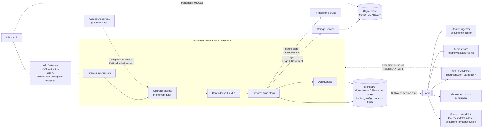

| Participant | Called how | When | Owns |
|---|---|---|---|
| API Gateway *(outside these repos; behaviour taken from config comments)* | — | Every request | JWT validation, identity headers, W3C baggage |
| **Permission Service** | Sync Feign `POST /api/permission/validate-action` | Every storage-touching API (no cache) | Workspace-level RBAC |
| **AccessArc** (guardrail control plane) | Snapshot at boot; Kafka "doorbell" triggers a refresh | **Not per request** | Per-endpoint rules (PLATFORM → TENANT → WORKSPACE → USER) |
| **MongoDB** | Spring Data | Every request | Documents, folders, types, bucket rules, trash, outbox |
| **Storage Service** | Sync HTTP | Depends on the API (§7) | Key layout, S3 I/O, presigned URLs, checksums |
| Object store | S3 SDK (from Storage) or presigned URL (from client) | Data plane | Bytes and S3 versions |
| **Kafka consumers** | Async, via the outbox | After commit | Search index, OCR/validation, audit trail, downstream reactions |

---

# Part B: The full request path

## 4. The common pipeline in Document Service (what happens before and after Storage)

Every storage-touching API passes through the same layers in this order. **⚡ marks a remote call.**

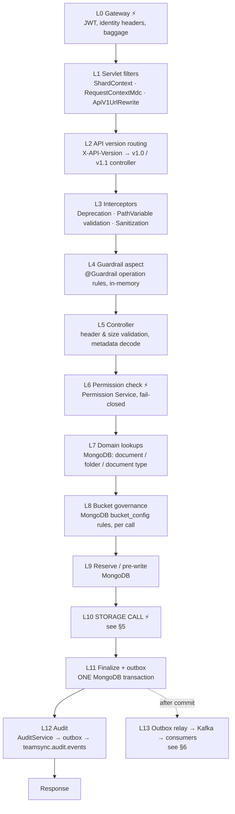

| Layer | Component (file) | What it does | Remote? | On failure |
|---|---|---|---|---|
| L0 | API Gateway | Validates the JWT and injects `X-Tenant-Id`, `X-User-Id`, `X-Workspace-Id`, and W3C `baggage` | ⚡ | 401/403 at the edge |
| L1 | `ShardContextFilter` | Stores shard-key values from headers. Inactive unless sharding is configured | — | — |
| L1 | `RequestContextMdcFilter` | Resolves caller identity **once** and writes it to log MDC, span attributes, and **baggage** (which travels to Permission, Storage, and Kafka headers) | — | — |
| L1 | `ApiV1UrlRewriteFilter` | Rewrites legacy `/api/v1/*` to `/api/*` and injects a default `X-API-Version` | — | — |
| L2 | Spring native API versioning (`WebConfig`) | Routes to the `version = "1.0"` or `"1.1"` handler | — | 400 for an unsupported version |
| L3 | `DeprecationInterceptor` | Adds `Deprecation`/`Sunset` headers, or returns **410 Gone** after the removal date | — | 410 |
| L3 | `PathVariableValidationInterceptor` | Path IDs must match `[A-Za-z0-9_-]` | — | 400 |
| L3 | `RequestSanitizationInterceptor` | Regex blocklist against XSS/injection in query params and `X-*` headers | — | 400 |
| L4 | **Guardrail** (`guardrail-engine-starter`, `@Guardrail(Operations.X)`) | Evaluates rules authored in AccessArc for this operation and scope (for example size or field limits). Uses an in-memory snapshot, so no per-request call. Startup fails if a mutating endpoint has no guard | — (snapshot) | 4xx per rule |
| L5 | Controller | Validates headers. v1.1 upload: rejects a too-large `Content-Length` **before reading the body**, decodes the Base64 `X-Document-Metadata` | — | 400 / 413 |
| L6 | `PermissionValidationService` → `PermissionClient` | `POST /api/permission/validate-action` with action `FILE_UPLOAD` / `FILE_DOWNLOAD` / `FILE_UPDATE` / `FILE_COPY` / `FILE_DELETE` / `FILE_READ`. **No cache.** Fallback is fail-closed | ⚡ | 403 if denied. **424** if the service is down |
| L7 | Repositories | Loads the document (tenant + workspace scoped, excluding deleted), parent folder, and document type. Validates `uploadStatus` (`UPLOADING` and `ABORTED` are rejected) | Mongo | 404 / 409 |
| L8 | `BucketResolutionService` + `BucketContextBuilder` | Evaluates the tenant's `bucket_config` rules in priority order (folder, type, MIME type, size, owner, tags). **First match wins**, otherwise the system default. **No caching** (one Mongo query per call) | Mongo | Falls back to the default bucket |
| L9 | `reserveDocumentInDB` | Inserts a placeholder document with the conflict strategy (`SAVE`, rename, and so on, up to 5 attempts). Presigned uploads use status `UPLOADING` | Mongo | 409 on a name conflict |
| **L10** | **Storage call** | See §5 | ⚡ | 4xx passthrough, or 424 |
| L11 | `outboxService.executeTransactionally` | **One Mongo transaction**: finalize the document *and* insert the outbox rows for its events | Mongo | Compensation (§9.3) |
| L12 | `AuditService.success(...)` in the controller. `GlobalExceptionHandler` records `failure`/`denied` | One audit event per request → outbox → `teamsync.audit.events` | Mongo | Logged, never fails the request |
| L13 | `OutboxPublisherService` (JobRunr `@Recurring`) | Claims a batch, sends to Kafka, marks it sent. A sweeper retries failures | Kafka | Retried. After 5 failures the row becomes `FAILED` and the sweeper picks it up |

## 5. What happens inside Storage Service

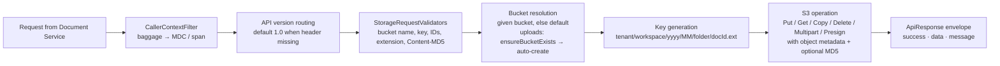

| Step | Detail |
|---|---|
| Identity | `CallerContextFilter` reads tenant, user, and workspace from baggage (falling back to headers) **for logs and traces only**. Nothing is authorized. |
| Validation | `StorageRequestValidators`: bucket name rules, storage-key safety, non-blank IDs, extension, and Base64/hex normalisation of `Content-MD5`. |
| Bucket | **Upload:** uses the bucket Document Service names, or the default (`teamsync-documents`), and **creates it if it is missing**. `uploadWithBucketGuard` recreates the bucket and retries once if it vanishes. **Read/delete:** never creates a bucket, and returns 404 `BUCKET_NOT_FOUND` if it is missing. |
| Key | `{tenantId}/{workspaceId}/{yyyy}/{MM}/[{folderId}/]{documentId}.{ext}` using the **current date**. |
| S3 write | Streams with the object metadata `tenantId, userId, workspaceId, folderId, docId, uploadedAt, originalFileName`. When `Content-MD5` is present, S3 verifies integrity server-side. The returned `checksum` is the S3 ETag. |
| **Not active** | `SecurityConfig` (authentication), `@RequiresPermission` (`PermissionAspect`), `RateLimitAspect`, quota enforcement (`StorageQuota`), the audit Kafka producer (`AuditKafkaConfig`), and `StorageEventPublisher` (injected but never called). **All are commented out or unused.** |

## 6. The async after-path (events fired by each request)

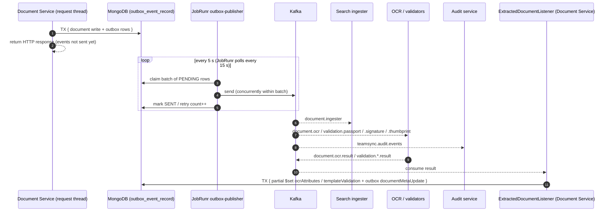

**Kafka topics produced on the paths in this document**

| Topic | Producer | Fired by | Consumer (intended) |
|---|---|---|---|
| `document.ingester` | `EsearchProducer.sendDocumentIngester` | Every upload that produces a storage key (#1–#5, #8, #9) | Search indexer |
| `document.ocr`, `validation.passport`, `validation.signature`, `validation.thumbprint` | `EsearchProducer.sendCapabilityEvents` | Uploads where `ocrFlag=true` **and** the document type lists those `requiredProcessors` | OCR / AI validators |
| `document.events` (`CREATED`, `UPDATED`, `COPIED`, `PERMANENTLY_DELETED`) | `DocumentEventProducer` | Upload, new version, copy, permanent delete | Downstream services |
| `documentMetaUpdate` | `EsearchProducer.sendDocumentMetaUpdate` | Arrival of OCR/validation results, attribute updates | Search |
| `documentPermanentDelete` | `EsearchProducer.sendPermanentDeleteEvent` | Permanent delete / empty trash | Search |
| `folder.events` (`COPIED`) + `documentMetaUpdate` (folder) | `FolderEventProducer`, `EsearchProducer` | Folder copy | Downstream services, search |
| `teamsync.audit.events` | `AuditProducerService` (via `AuditService`) | **Every** API (success, failure, denied) | Audit service |

> **Consistency note:** Events are delivered **at least once** and **after** the response. The search index and OCR results lag behind the API response by about 5–15 s or more. Consumers must be idempotent (key on `documentId` + event id).

---

# Part C: Per-API traces

## 7. Composition map: trace card per API

Legend: **F** = Feign `StorageServiceV2Client` · **R** = RestClient (control plane) · **R-S** = RestClient streaming (data plane) · **Perm** = Permission Service action.

### 7.1 Upload & create

| # | API | Guardrail op | Perm | Steps before Storage | Storage call(s) | Steps after Storage | Events | Audit |
|---|---|---|---|---|---|---|---|---|
| 1 | `POST /api/documents` v1.0 (multipart) | `DOCUMENT_UPLOAD` | `FILE_UPLOAD` | parent folder, document type, attributes validation, reserve, bucket rules | `POST /api/storage/upload` **R-S** (v1.1) | TX finalize + events. On failure: rollback + `DELETE /files/delete-by-metadata` (**F**) | ingester, capability\*, `CREATED` | `DOCUMENT_CREATE` |
| 2 | `POST /api/documents` v1.1 (octet) | `DOCUMENT_UPLOAD_STREAM` | `FILE_UPLOAD` | size cap before reading the body, metadata decode, same as #1 | same, **no retry** (one-shot stream) | same as #1 | same | `DOCUMENT_CREATE` |
| 3 | `POST /api/documents/from-template` v1.0 | `DOCUMENT_CREATE_FROM_TEMPLATE` | `FILE_UPLOAD` | loads the template, then #1 | same as #1 | same as #1 | same | `DOCUMENT_CREATE_FROM_TEMPLATE` |
| 4 | `POST /api/documents/upload/initiate` | `DOCUMENT_UPLOAD_INITIATE` | `FILE_UPLOAD` | reserve (`UPLOADING`), bucket rules | `POST /api/storage/upload/initiate` **F** | stores `uploadId`. On failure: rollback reservation | — | `PRESIGNED_UPLOAD_INITIATE` |
| 5 | `POST /api/documents/upload/complete` | `DOCUMENT_UPLOAD_COMPLETE` | `FILE_UPLOAD` | finds the document in `UPLOADING` | `POST /api/storage/upload/complete` **F** | TX finalize + events | ingester, capability\*, `CREATED` | `PRESIGNED_UPLOAD_COMPLETE` |
| 6 | `GET /api/documents/upload/status` | `DOCUMENT_UPLOAD_STATUS` | `FILE_UPLOAD` | finds the document in `UPLOADING` | `GET /api/storage/upload/status` **F** | — | — | `PRESIGNED_UPLOAD_STATUS` |
| 7 | `POST /api/documents/upload/abort` | `DOCUMENT_UPLOAD_ABORT` | `FILE_UPLOAD` | finds the document in `UPLOADING` | `POST /api/storage/upload/abort` **F** (multipart only, best effort) | marks `ABORTED` | — | `PRESIGNED_UPLOAD_ABORT` |
| 8 | `POST /api/documents/upload/at-once` | `DOCUMENT_UPLOAD_AT_ONCE` | `FILE_UPLOAD` | #4 | initiate → **PUT parts to S3 directly** → status → complete (→ abort) | #5 | as #5 | `DOCUMENT_CREATE` |
| 9 | `POST /api/document-migrations` (bulk) | `MIGRATION_PROCESS` | `FILE_UPLOAD` per item | idempotency key, per-item folder/type, reserve, checksum dedup | `POST /api/storage/files/copy-with-reconciliation` **R** | TX finalize + events (per item) | ingester, capability\*, `CREATED` | per guard |

\* capability events fire only when `ocrFlag=true` and the document type declares `requiredProcessors`.

### 7.2 Read & download

| # | API | Guardrail op | Perm | Steps before Storage | Storage call | Steps after | Events | Audit |
|---|---|---|---|---|---|---|---|---|
| 10 | `GET /api/documents/{id}/download` v1.0 / v1.1 | `DOCUMENT_DOWNLOAD` / `_STREAM` | `FILE_DOWNLOAD` | load document, check status | `GET /api/storage/download` **R** (read retry ×3) | stream pass-through, `Content-Disposition: attachment` | — | `DOCUMENT_DOWNLOAD_STREAM` |
| 11 | `GET /api/documents/{id}/open` v1.0 | `DOCUMENT_OPEN` | `FILE_DOWNLOAD` | same | same | **buffers** the whole file (capped), `inline` | — | `DOCUMENT_OPEN` |
| 12 | `GET /api/documents/{id}/open` v1.1 | `DOCUMENT_OPEN_STREAM` | `FILE_DOWNLOAD` | same + **ETag / `If-None-Match` → 304 without calling Storage** | same (forwards `Range`) | stream, `inline`, `nosniff`, `Last-Modified` | — | `DOCUMENT_OPEN_STREAM` |
| 13 | `GET /api/documents/{id}/download/presigned-url` | `DOCUMENT_DOWNLOAD_PRESIGNED_URL` | `FILE_DOWNLOAD` | load document | `POST /api/storage/download/presigned-url` **F** | returns the URL. The client then GETs from S3 | — | `DOCUMENT_PRESIGNED_DOWNLOAD_URL` |
| 14 | `GET /api/documents/{id}/versions` | `DOCUMENT_VERSION_LIST` | `FILE_READ` | load document, reject `UPLOADING`/`ABORTED` | `GET /api/buckets/{bucket}/document-versions` **F** | **merges** the S3 list with MongoDB version info (true API composition) | — | `VERSION_LIST` |
| 15 | `GET /api/documents/{id}/versions/{versionId}/download` | `DOCUMENT_VERSION_DOWNLOAD` | `FILE_DOWNLOAD` | load document | `GET /api/storage/download/versions/zip` **R** | streams the ZIP | — | `VERSION_DOWNLOAD` |

### 7.3 Modify, copy & delete

| # | API | Guardrail op | Perm | Steps before Storage | Storage call | Steps after | Events | Audit |
|---|---|---|---|---|---|---|---|---|
| 16 | `POST /api/documents/{id}/versions` (`finalSave=true`) | `DOCUMENT_VERSION_CREATE` | `FILE_UPDATE` | load document, check status, optional SHA-256 | `POST /api/storage/files/version` **R-S** (v1.1) | TX: version counter +1, `s3VersionId`, size + `UPDATED` | `UPDATED` | `VERSION_CREATE` |
| 17 | `POST /api/documents/{id}/copy` (`deepCopyBinary=true`) | `DOCUMENT_COPY` | `FILE_COPY` | load source, unique name in target, bucket rules for target | `POST /api/storage/files/copy` **F** | TX save copy + `COPIED`. On failure: `DELETE /api/storage/files` | `COPIED` | `DOCUMENT_COPY` |
| 18 | `POST /api/folders/{folderId}/copy` | `FOLDER_COPY` | `FILE_CREATE` + `FILE_COPY` per document | copy folder tree (TX + `folder.events`) | #17 **once per document** (sequential) | as #17 | `folder.events COPIED`, folder meta, `COPIED` × N | `FOLDER_COPY` |
| 19 | `DELETE /api/trash/{itemId}`, `DELETE /api/trash` | `TRASH_DELETE_PERMANENT` / `TRASH_EMPTY` | `FILE_DELETE` | load trash entry and its children | `DELETE /api/storage/files` **F** per document, ⚠ **inside the Mongo TX** | delete DB row | `PERMANENTLY_DELETED`, `documentPermanentDelete` | `TRASH_PERMANENT_DELETE` / `TRASH_EMPTY` |

### 7.4 Declared but never reached from a public API

| Storage endpoint | Client method | Status |
|---|---|---|
| `GET /api/storage/download/bytes` | Feign `downloadBytes` | `@Deprecated(forRemoval)` after causing an OOM outage. Remove it. |
| `POST /api/storage/files/version` (multipart) | Feign `createVersionMultipart` | Replaced by the streaming version. Remove it. |
| `POST /api/storage/files/copy` | RestClient `copyObject` via `uploadDocumentServerSideCopy` | No controller calls it. Remove it or wire it up. |

## 8. Detailed end-to-end sequences

### 8.1 Direct upload v1.1 (APIs #1–#3): complete trace

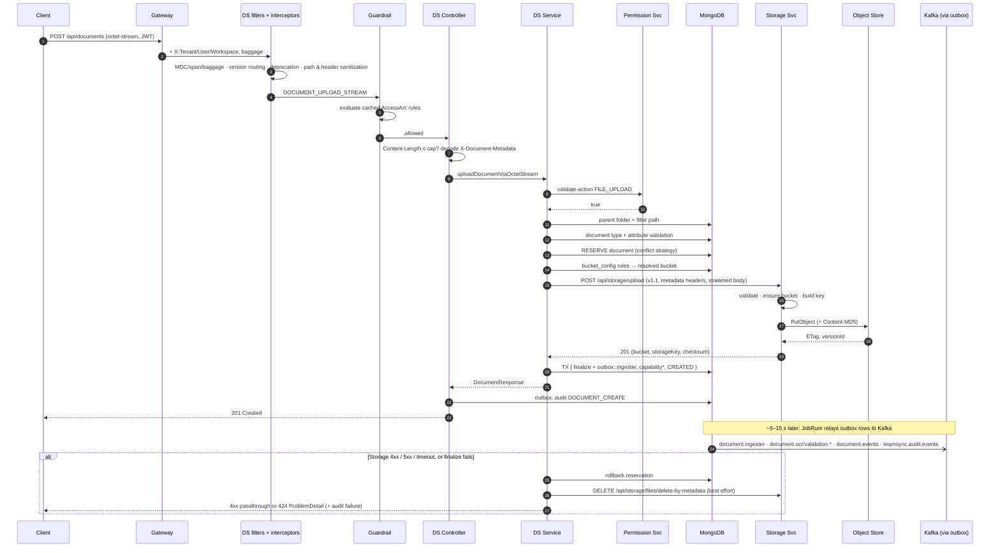

### 8.2 Presigned upload (APIs #4–#8): Valet Key + saga

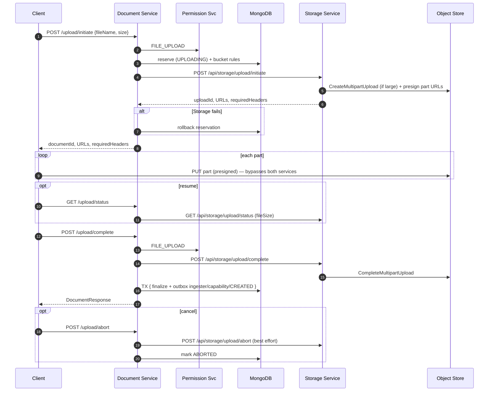

### 8.3 Open / download v1.1 (APIs #10, #12)

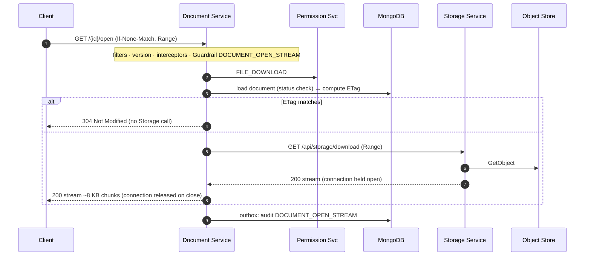

### 8.4 Copy (APIs #17, #18)

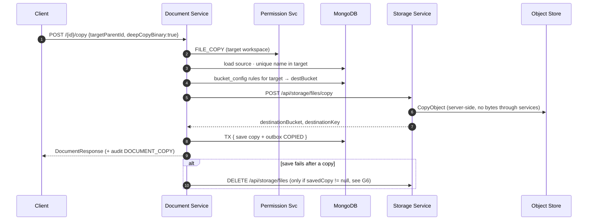

### 8.5 New version, version list, version ZIP (APIs #14–#16)

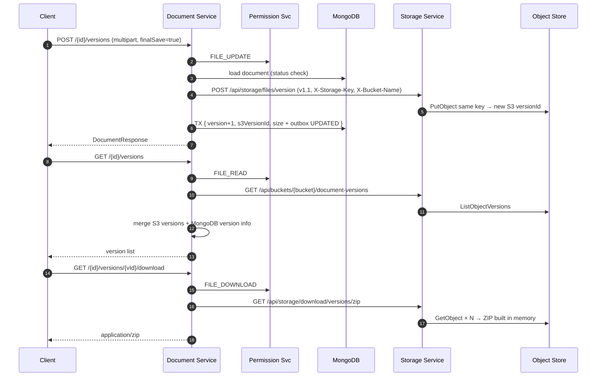

### 8.6 Permanent delete / empty trash (API #19)

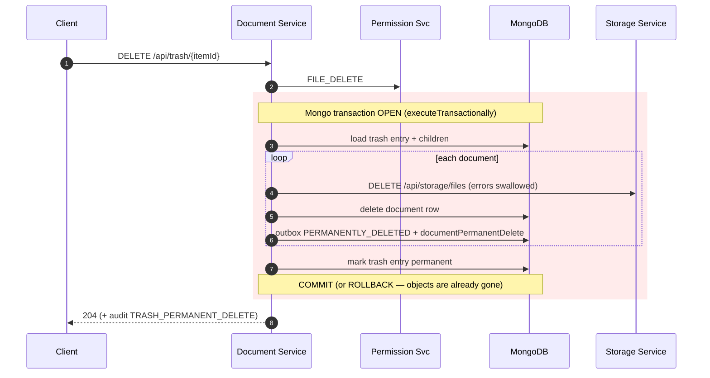

### 8.7 Bulk migration (API #9)

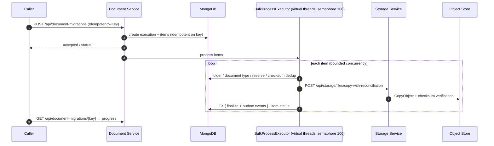

---

# Part D: Contract & non-functional behaviour

## 9. Contract, resilience, failure handling

### 9.1 Headers propagated to Storage

| Header | Data-plane uploads (#1–3, #16) | Control-plane calls | Purpose |
|---|---|---|---|
| `X-API-Version` | `1.1` (from `storage-rest-client.api-version`) | **not sent** (Storage uses its default, `1.0`) | Contract version |
| `X-Tenant-Id`, `X-User-Id` | ✅ | `delete-by-metadata` only. Other calls put IDs in the body or query string | Tenancy and attribution |
| `X-Workspace-Id`, `X-Doc-Id`, `X-Folder-Id`, `X-File-Name` | ✅ | — | Key derivation and object metadata |
| `X-Bucket-Name`, `X-Storage-Key` | ✅ | In the query string or body | Target location |
| `X-Sha256`, `Content-MD5` | Optional | — | Integrity |
| `Range` | — | Open v1.1 | Partial content |
| `X-Internal-Service: content-service` | — | Downloads and ZIP | Caller tag (informational) |
| `traceparent`, `baggage` | ✅ automatic (OpenTelemetry) | ✅ | Trace and identity propagation |

### 9.2 Timeout budget & resilience

| Hop | Timeout | Circuit breaker | Retry |
|---|---|---|---|
| Permission Service (Feign) | connect 5 s, read **32 s** (temporarily widened), TimeLimiter 30 s | yes | Feign default: none |
| Storage via Feign | connect 5 s, read 120 s | `storageServiceV2Client` (30 s time window, ≥20 calls, opens at 50% failures or 90% slow calls >20 s, stays open 10 s) | none |
| Storage via RestClient, write | connect 5 s, socket 120 s (**dev 1800 s**), pool wait 3 s | `storage-rest-write` | 2 attempts, **connect-phase failures only**. v1.1 octet upload: none |
| Storage via RestClient, read | same pool | `storage-rest-read` | 3 attempts, 500 ms × 2 backoff |
| Connection pool | 200 total / 200 per route | — | — |
| Outbox → Kafka | publish timeout 15 s | — | 5 retries, then the `FAILED` sweeper |

**Worst-case synchronous latency** of an upload before it fails is about 32 s (Permission) + 120–1800 s (Storage) + Mongo time. There is **no end-to-end deadline**, so each hop has its own timeout and the times add up (gap G11).

### 9.3 Failure matrix (upload saga; other writes follow the same shape)

| Step fails | State left behind | Compensation | Client sees |
|---|---|---|---|
| Guardrail / validation / size | nothing | — | 400 / 413 / rule-specific 4xx |
| Permission denied / down | nothing | — | 403 / **424** |
| Folder / type lookup | nothing | — | 404 / 400 |
| Reserve (name conflict) | nothing | — | 409 (or auto-rename, per strategy) |
| Storage 4xx | reserved row | rollback reservation + orphan delete | same 4xx |
| Storage 5xx / timeout / circuit open | reserved row, **maybe** a written object | rollback reservation + `delete-by-metadata` (best effort, see G3) | **424** `DOC-424-001` |
| Finalize TX fails | reserved row + **written object** | rollback reservation + `delete-by-metadata` | 500 |
| Outbox relay / Kafka down | committed document, PENDING events | retry ×5 → sweeper | 201 (events delayed) |
| Audit enqueue fails | — | logged | unaffected |
| **Delete:** Storage DELETE fails | object remains, DB row deleted | **none** (G9) | 204 |
| **Delete:** TX rolls back after Storage DELETE | **DB row remains, object gone** | **none** (G2) | 5xx |

### 9.4 Error contract

| Storage response | Document Service response |
|---|---|
| 4xx (validation, not found, conflict, 413, 415, 429) | Same status, mapped to a domain exception. Not counted by the circuit breaker. |
| 5xx, timeout, connection refused, open circuit | `ExternalServiceException` → **424 `DOC-424-001 Storage Service Unavailable`**, RFC 9457 `ProblemDetail`, audit `failure`. |

## 10. Observability along the trace

| Signal | Document Service | Storage Service |
|---|---|---|
| **Distributed trace** | OpenTelemetry starter. Spans for HTTP in/out, Feign, RestClient, and Kafka | OpenTelemetry starter + OTLP exporter |
| **Identity on spans and logs** | `RequestContextMdcFilter` → MDC, span attributes, baggage | `CallerContextFilter` → MDC, span attributes |
| **Kafka context** | Baggage injected into record headers. `BaggageMdcRecordInterceptor` restores it on consume | — |
| **Structured logs** | `event.name key=value` (for example `document.upload.success … latencyMs=`) | Plain-text info logs |
| **Metrics** | `document.ingestion.enqueue.total{type,outcome}`, Resilience4j breaker/retry metrics, an actuator endpoint to reset circuit breakers | Actuator |
| **Audit** | One event per request (success, failure, or denied) → `teamsync.audit.events` | **None** (audit producer disabled) |

---

# Part E: Assessment

## 11. Industry best-practice scorecard

| # | Practice | Status | Evidence / gap |
|---|---|---|---|
| 1 | Single orchestrator, with the downstream hidden from clients | ✅ | Clients only call `/api/documents/**`. |
| 2 | Edge authentication + identity propagation | ✅ | Gateway JWT, then baggage across HTTP and Kafka. |
| 3 | **Zero-trust between services** (mTLS / service JWT) | ❌ | Storage (security commented out) and AccessArc (per `application-dev.yml` comments) accept unauthenticated in-cluster calls. Document Service sends no service credential to any downstream. **G1** |
| 4 | Authorization **in the orchestrator**, fail-closed | ✅ | `require(...)`, and the fallback returns 424 rather than allowing. |
| 5 | Policy / guardrail enforcement at the API boundary | ✅ | `@Guardrail` on every endpoint, and startup fails if one is missing. |
| 6 | Input validation and sanitization at the boundary | ✅ | Path, header, and query interceptors, plus size checks before reading the body. |
| 7 | Saga with compensation, no distributed transaction | 🟡 | Upload and copy: yes. Orphan cleanup is unreliable (**G3**) and copy rollback is mostly unreachable (**G6**). |
| 8 | **Never hold a DB transaction across a remote call** | 🟡 | Upload, copy, and version: correct. **Permanent delete / empty trash: violated (G2).** *(v1 wrongly said this was enforced everywhere.)* |
| 9 | Transactional outbox for events | ✅ | Every producer goes through `EventPublisher` → outbox → JobRunr. |
| 10 | Separate control plane and data plane; stream large payloads | ✅ | Streaming RestClient. No full-file copy in memory, except v1.0 `/open` and the Storage ZIP (**G4**). |
| 11 | Valet key (presigned URLs) | ✅ | Presigned upload and download. |
| 12 | Timeouts on every hop | ✅ | All hops have one. |
| 13 | **Deadline / timeout budget** across the chain | ❌ | Timeouts add up; nothing propagates a deadline. **G11** |
| 14 | Circuit breaker + fallback, 4xx ≠ failure | ✅ | Three breakers, plus `StorageFailurePredicate`. |
| 15 | Retry only safe or idempotent operations | ✅ | Connect-phase-only retry for writes. No retry for one-shot streams. |
| 16 | Bulkheads (read vs write isolation) | 🟡 | One shared pool of 200 connections. |
| 17 | Idempotency on mutating calls | 🟡 | Bulk migration has an idempotency key. Upload, copy, and version calls do not. |
| 18 | Explicit contract versioning on every call | 🟡 | Only data-plane calls pin `1.1`. **G10** |
| 19 | Consistent error contract (RFC 9457) | ✅ | `ProblemDetail` + `DOC-xxx` codes. |
| 20 | Distributed tracing + correlated logs + audit | ✅ / 🟡 | Strong in Document Service. Storage has no audit. |
| 21 | Cache hot, slow-changing lookups | 🟡 | Permission and bucket rules hit their stores on **every** call. **G12** |
| 22 | Downstream protects itself (authorization, rate limit, quota) | ❌ | All disabled in Storage. **G1** |
| 23 | One client technology per downstream | 🟡 | Feign + RestClient both call `/files/copy`. **G13** |

**Verdict:** The *orchestration design* is mature and matches industry practice: saga, outbox, valet key, streaming, circuit breakers, and idempotency-aware retries. What keeps it from being fully best-practice is **security between services** (G1), **one transaction-boundary violation** (G2), **unreliable compensation** (G3, G6, G7, G9), and **no end-to-end deadline** (G11).

## 12. Gaps & recommendations

🔴 fix now · 🟠 next sprint · 🟢 housekeeping. *"Verify"* means the code shows the behaviour, but the consumer side lives in another repository.

| ID | Pri | Gap | Impact | Recommendation |
|---|---|---|---|---|
| **G1** | 🔴 | **Storage has no authentication, authorization, rate limit, quota, or audit.** `SecurityConfig`, `PermissionAspect`/`@RequiresPermission`, `RateLimitAspect`, and `AuditKafkaConfig` are commented out, and `StorageEventPublisher` is never called. Uploads **auto-create any named bucket**. | Any pod can read or delete any tenant's objects or create buckets, and nothing records it. | mTLS (mesh) or an OAuth2 client-credentials service JWT, plus a NetworkPolicy that allows only Document Service. Re-enable the rate limit and audit. Allow-list the buckets that can be created. |
| **G2** | 🔴 | **Permanent delete / empty trash calls `DELETE /api/storage/files` inside a Mongo transaction** (`TrashServiceImpl.permanentlyDeleteRecursive` → `executeTransactionally` → `deleteDocumentFromStorageAndDb`). | If the transaction aborts or times out (Mongo's default transaction lifetime is 60 s; large folders × 120 s Feign timeout), **the objects are already deleted but the DB rows survive**, leaving broken documents. | Commit the DB change first (mark `PENDING_PURGE` + outbox event), then delete from Storage **asynchronously** with retries (an outbox-driven purge worker). |
| **G3** | 🔴 | **Orphan cleanup can miss the object.** ① `delete-by-metadata` is called **without `bucketName`**, so Storage deletes from the default bucket. ② Storage **rebuilds the key using today's `yyyy/MM`**, so cleanup across a month boundary targets the wrong key. | Objects from failed uploads leak (cost, and data that is never cleaned up). | Delete by the **exact `bucketName` + `storageKey`** returned by the upload. When the upload response was lost, use a reconciliation job that scans S3 metadata (`docId`) against MongoDB. |
| **G4** | 🟠 | **Storage builds the version ZIP fully in memory** (`downloadAllVersionsAsZip` returns `byte[]`). | Same OOM class as the earlier `/download/bytes` incident. | Stream it with `StreamingResponseBody` + `ZipOutputStream`, and cap the number of versions. |
| **G5** | 🟠 | **`Range` is forwarded, but Storage ignores it** (always 200, full body). **`/versions/{versionId}/download` ignores `versionId`** and returns a ZIP of all versions. | Contracts that don't match their behaviour. Wasted bandwidth. | Implement ranged `GetObject` → 206. Route single-version downloads to `/api/storage/download/version`. |
| **G6** | 🟠 | Copy rollback runs only if `savedCopy != null`, so when the DB save fails, the copied object is orphaned. | Orphan objects. | Track `destinationKey` from the Storage response and compensate on any failure after the copy. |
| **G7** | 🟠 | **Shallow copy shares the storage key** (`deepCopyBinary=false`, or Storage returns `success=false`). Permanently deleting one document then deletes the object both documents use. | Silent data loss. | Fail the copy when Storage returns `success=false`. Before deleting from Storage, check whether any other document still references the key. |
| **G8** | 🟠 | *Verify:* **copy and new version publish no search/OCR ingestion event** (only `document.events COPIED/UPDATED`). | The copied document, or the new version's content, may never be indexed or OCR'd. | Confirm with the search team that `document.events` is consumed. Otherwise also emit `document.ingester` (and capability events) after a copy or a new version. |
| **G9** | 🟠 | Storage delete failures are swallowed (trash, presigned abort). | Unreferenced objects. | Use the outbox-driven purge from G2, plus a periodic reconciliation. |
| **G10** | 🟢 | Control-plane calls send no `X-API-Version`. | A change to Storage's default version silently changes behaviour. | Pin the version on both clients with a shared interceptor. |
| **G11** | 🟠 | No end-to-end deadline. Timeouts add up (Permission 32 s + Storage up to 1800 s in dev). | Requests and threads held for minutes. Clients time out before the server gives up. | Propagate a request deadline (for example a `X-Request-Deadline` header or OTel baggage), size each hop's timeout from the remaining budget, and fail fast. |
| **G12** | 🟢 | Permission and bucket rules are fetched on **every** call (no cache). | +1 network round trip and +1 Mongo query per request, and a hard dependency on Permission Service. | Short-TTL cache (for example Caffeine, 30–60 s) keyed by user + workspace + action, invalidated by an event. Cache bucket rules per tenant. |
| **G13** | 🟢 | Two client technologies (Feign + RestClient) for one downstream. Dead methods remain (`downloadBytes`, `createVersionMultipart`, `copyObject`). | Duplicated config and a risk of reusing an endpoint that caused an outage. | Converge on RestClient / `@HttpExchange`, and delete the dead methods. |
| **G14** | 🟢 | No idempotency key on Storage write calls. | Retried writes can create duplicate S3 versions. | Use `X-Doc-Id` as the idempotency key, with a conditional put (`If-None-Match: *`) on first upload. |
| **G15** | 🟢 | Outbox latency: the `@Recurring` interval is 5 s, but JobRunr polls every 15 s. | Search and OCR lag behind uploads by up to ~15 s or more. | Lower `JOBRUNR_POLL_INTERVAL`, or trigger a publish right after commit. |

---

## Appendix A: Code references

| Concern | Document Service |
|---|---|
| Filters / interceptors | [RequestContextMdcFilter](../src/main/java/com/teamsync/documentservice/config/RequestContextMdcFilter.java), [ApiV1UrlRewriteFilter](../src/main/java/com/teamsync/documentservice/versioning/ApiV1UrlRewriteFilter.java), [DeprecationInterceptor](../src/main/java/com/teamsync/documentservice/versioning/DeprecationInterceptor.java), [PathVariableValidationInterceptor](../src/main/java/com/teamsync/documentservice/config/PathVariableValidationInterceptor.java), [RequestSanitizationInterceptor](../src/main/java/com/teamsync/documentservice/config/RequestSanitizationInterceptor.java), [WebConfig](../src/main/java/com/teamsync/documentservice/config/WebConfig.java) |
| Guardrail operations | [Operations.java](../src/main/java/com/teamsync/documentservice/guardrail/Operations.java) |
| Permission | [PermissionValidationService](../src/main/java/com/teamsync/documentservice/service/PermissionValidationService.java), [PermissionClient](../src/main/java/com/teamsync/documentservice/client/PermissionClient.java) |
| Bucket governance | [BucketResolutionService](../src/main/java/com/teamsync/documentservice/governance/service/BucketResolutionService.java), [BucketContextBuilder](../src/main/java/com/teamsync/documentservice/governance/service/BucketContextBuilder.java) |
| Storage clients | [StorageServiceV2Client](../src/main/java/com/teamsync/documentservice/client/StorageServiceV2Client.java), [StorageRestClientV2](../src/main/java/com/teamsync/documentservice/client/restclient/StorageRestClientV2.java) |
| Upload saga / postProcess | [DocumentCreationServiceImpl](../src/main/java/com/teamsync/documentservice/service/impl/DocumentCreationServiceImpl.java) |
| Presigned | [PresignedUploadServiceImpl](../src/main/java/com/teamsync/documentservice/service/impl/PresignedUploadServiceImpl.java) |
| Download / open | [DocumentDownloadAndOpenServiceImpl](../src/main/java/com/teamsync/documentservice/service/impl/DocumentDownloadAndOpenServiceImpl.java) |
| Copy / version | [DocumentModificationServiceImpl](../src/main/java/com/teamsync/documentservice/service/impl/DocumentModificationServiceImpl.java), [DocumentServiceImpl](../src/main/java/com/teamsync/documentservice/service/impl/DocumentServiceImpl.java), [VersionControllerV1_0](../src/main/java/com/teamsync/documentservice/controller/v1_0/VersionControllerV1_0.java) |
| Trash | [TrashServiceImpl](../src/main/java/com/teamsync/documentservice/service/impl/TrashServiceImpl.java) |
| Outbox / Kafka | [OutboxServiceImpl](../src/main/java/com/teamsync/documentservice/outbox/service/impl/OutboxServiceImpl.java), [OutboxPublisherService](../src/main/java/com/teamsync/documentservice/outbox/service/OutboxPublisherService.java), [EsearchProducer](../src/main/java/com/teamsync/documentservice/kafka/producer/EsearchProducer.java), [DocumentEventProducer](../src/main/java/com/teamsync/documentservice/kafka/producer/DocumentEventProducer.java), [ExtractedDocumentListener](../src/main/java/com/teamsync/documentservice/kafka/ExtractedDocumentListener.java) |
| Audit | [AuditService](../src/main/java/com/teamsync/documentservice/service/impl/AuditService.java), [AuditProducerService](../src/main/java/com/teamsync/documentservice/kafka/producer/AuditProducerService.java) |
| Config | [application.yml](../src/main/resources/application.yml), [application-dev.yml](../src/main/resources/application-dev.yml) |

| Concern | Storage Service (`com.teamsync.storage`) |
|---|---|
| Controllers | `controller/v1_1/UploadControllerV1_1`, `v1_1/FileVersionControllerV1_1`, `v1_0/MultipartUploadController`, `v1_0/DownloadControllerV1`, `v1_0/FileOpsControllerV1`, `v1_0/FileCopyReconciliationController`, `v1_0/DeleteControllerV1`, `v1_0/BucketController` |
| Core logic | `service/StorageServiceImpl` (`uploadFileStream`, `deleteFileByExtension`, `generateStorageKey`, `resolveBucketForUpload`) |
| Inactive protections | `config/SecurityConfig`, `permission/PermissionAspect`, `aspect/RateLimitAspect`, `config/AuditKafkaConfig`, `event/StorageEventPublisher` |

## Appendix B: Glossary

| Term | Meaning |
|---|---|
| **Saga** | A multi-step business operation where each step commits locally and failures are undone by *compensating* actions. |
| **Outbox** | Events are stored in the same DB transaction as the data change, then relayed to Kafka later. |
| **Valet key** | A short-lived signed URL that gives the client direct, limited access to the object store. |
| **Control / data plane** | Small JSON control calls vs. large streamed file bytes, each with its own client and settings. |
| **Circuit breaker** | Stops calling a failing service for a cool-down period so failures don't cascade. |
| **Guardrail** | Rules authored centrally (AccessArc) and enforced per endpoint and scope without a redeploy. |
| **Baggage** | W3C header that carries tenant, user, and workspace across every HTTP and Kafka hop. |
