# Scality RING: The Simple Guide

### From zero to production design, explained step by step in plain language

| | |
| --- | --- |
| **Document type** | Learning guide |
| **Date** | 23 October 2026 |
| **Level** | Beginner → Production design |
| **Related files** | [Scality-RING-Architecture.md](Scality-RING-Architecture.md) (expert reference) · `Scality-RING-Client-Presentation.pptx` (client deck) |

> **Viewing the diagrams:** this guide uses **Mermaid** diagrams. In VS Code, install the extension **"Markdown Preview Mermaid Support"**, then press `Ctrl + Shift + V` to open the preview. GitHub, GitLab and Obsidian show them automatically.

---

## How to read this guide

Every idea is explained with an **everyday example first**, and the **real Scality name is always written in brackets**:

> **Packer (sproxyd)** means the everyday name is *packer*, and in Scality it is called **sproxyd**.

Each lesson is built the same way:

1. **In one line:** the whole lesson in one sentence.
2. **Steps:** the idea explained slowly, with diagrams.
3. **Summary:** the points to remember.

---

## Table of contents

| Part | Lesson | Topic |
| --- | --- | --- |
| 1. Fundamentals | 1 | The big picture: what RING is |
| | 2 | The Front desk (Connector): who breaks the file? |
| | 3 | The Notebook (Metadata) |
| | 4 | Inside a Shelf (Storage server) |
| | 5 | The Round table (Ring): how pieces are placed |
| 2. Operations | 6 | When a server dies (Self-healing) |
| | 7 | Adding servers (Expansion and Balance) |
| 3. Infrastructure | 8 | Multiple buildings (Multi-site) |
| | 9 | The network |
| 4. S3 | 10 | How applications talk to RING (S3) |
| 5. Design | 11 | Designing a real production cluster |
| Reference | 12 | Name map: everyday name → Scality name |

---

# Part 1: Fundamentals

---

## Lesson 1: The big picture

> **In one line:** Scality RING joins many normal servers together so they behave like **one giant, safe storage system**.

### Step 1: What problem does RING solve?

A company has **too much data**: backups, videos, photos, files. It can be billions of files and thousands of terabytes.

- **One computer cannot hold that much.**
- If that one computer dies, **everything is lost**.

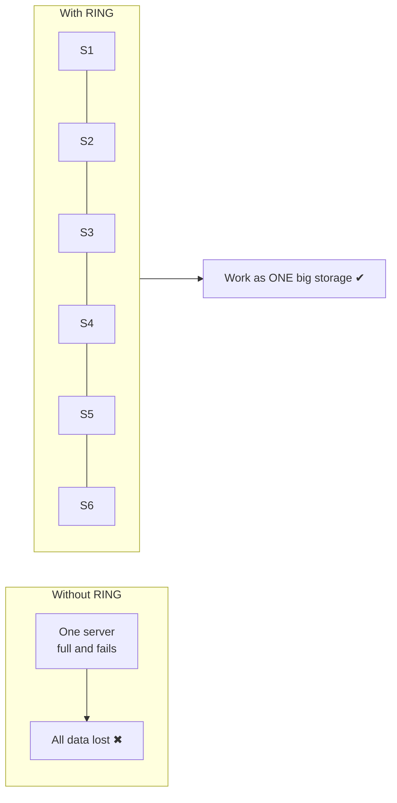

### Step 2: Think of it as a big warehouse

| Warehouse | Scality RING |
| --- | --- |
| Customer bringing a parcel | Application, e.g. Veeam backup |
| **Front desk** that takes and returns parcels | **Connector** (S3, NFS, SMB) |
| **Shelves** where parcels are kept | **Storage servers** with hard disks |
| **Manager's office** that watches everything | **Supervisor** |

The customer **never walks into the shelves**. They only talk to the front desk.

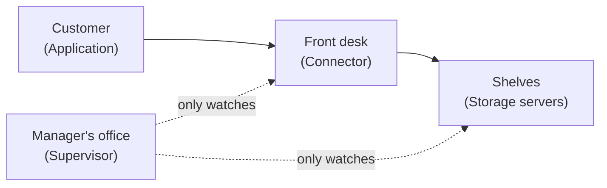

If the **Manager's office (Supervisor)** closes for a day, the warehouse **still works**. The manager only watches and configures.

### Step 3: Five ideas to remember

| # | Idea |
| --- | --- |
| 1 | RING = **many servers working as one** |
| 2 | **No boss server.** All are equal, so no single failure stops everything |
| 3 | Data is **cut into pieces** and **spread** over many servers |
| 4 | Broken disks and servers are **repaired automatically** |
| 5 | To grow, just **add more servers** |

---

## Lesson 2: The Front desk (Connector): who breaks the file?

> **In one line:** The **Front desk (Connector)** breaks the file into pieces. The **Storage servers** never cut anything; they only keep the pieces.

### Step 1: The front desk has two workers inside

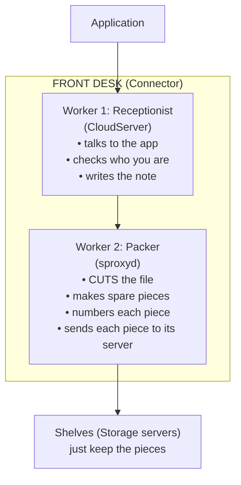

### Step 2: Who does what

| Job | Who does it |
| --- | --- |
| Receive the file from the app | Receptionist (CloudServer) |
| Check the user is allowed | Receptionist with Security office (Vault) |
| **Cut the file into pieces** | **Packer (sproxyd)** |
| **Make the 3 extra spare pieces** | **Packer (sproxyd)** |
| Decide which server gets each piece | Packer (sproxyd), using the Round table (Ring) |
| Store the pieces on disk | Shelves (Storage servers) |
| Remember "file X = these pieces" | Notebook (Metadata) |

### Step 3: Small file or big file?

The **Packer (sproxyd)** decides based on size:

| File | What the Packer does | Scality name |
| --- | --- | --- |
| **Big** | **Cuts** it into **9 pieces + 3 spare pieces = 12** | Erasure coding (ARC 9+3) |
| **Small** | **Does not cut**; makes **3 photocopies** | Replication (COS 2) |

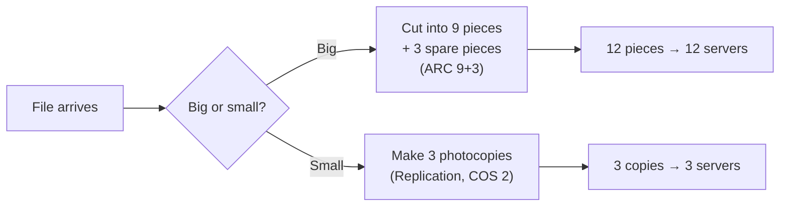

### Step 4: Puzzle pieces explained

1. Cut the file into **9 puzzle pieces**.
2. Make **3 extra "magic" pieces** (Parity fragments).
3. That gives 12 pieces, stored on **12 different servers**.
4. **Any 9 of the 12 can rebuild the whole file.**

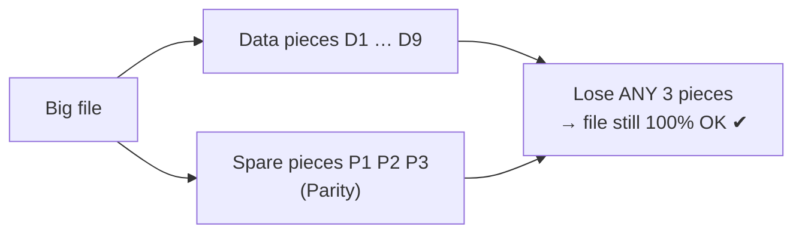

This is as safe as photocopies but uses **much less space**: about 1.33× instead of 3×.

### Step 5: Saving and reading

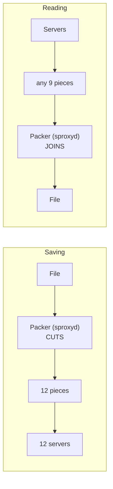

### Summary

- The **Front desk (Connector)** is the **smart part**: it cuts and joins.
- The **Shelves (Storage servers)** are the **simple part**: they keep pieces safe.
- **Small files get photocopies (Replication), big files get puzzle pieces (Erasure coding / ARC).**

---

## Lesson 3: The Notebook (Metadata)

> **In one line:** The **Notebook (Metadata service)** remembers which pieces make up each file. It is kept in **5 copies** that stay identical through a **leader and majority vote (Raft)**.

### Step 1: Why do we need a notebook?

The Packer cut the file into 12 pieces and sent them to 12 servers. Later the app says: **"Give me my file `holiday.mp4`."**

How does the front desk know where the 12 pieces are? It must have **written it down**. That note is the **Notebook (Metadata)**.

### Step 2: What is written in the notebook?

One page per file:

```
 ┌──────────────────────────────────────────────────┐
 │ File name (Object key):  holiday.mp4             │
 │ Folder (Bucket):         my-videos               │
 │ Size:                    100 MB                  │
 │ Owner:                   Ravi                    │
 │ Saved on:                23 Oct 2026             │
 │ Version:                 2                       │
 │ Locked? (Object Lock):   Yes, until 2027         │
 │ Pieces at (Ring keys):   4821, 9930, 1177 ...    │  ← most important line
 └──────────────────────────────────────────────────┘
```

| What | Where it lives |
| --- | --- |
| The actual video (the pieces) | Shelves (Storage servers) |
| The page *about* the video | Notebook (Metadata servers) |

### Step 3: The notebook is precious, so we keep 5 copies

If the notebook is lost, the pieces are still on the shelves, but **nobody knows which pieces belong to which file**. It would be like a library with no catalogue.

So the notebook is kept on **5 separate notebook servers** with fast SSD/NVMe disks:

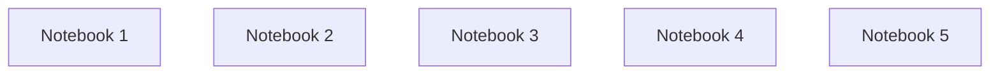

### Step 4: How do 5 notebooks stay the same? (Raft)

- **Rule 1: Only one writer, the leader.** One of the 5 is chosen as **leader**. Only the leader accepts new writes.
- **Rule 2: The majority must agree.** The leader writes the page and sends it to the others. When **3 of 5** have it, the page is **officially saved**.
- **Rule 3: If the leader dies, the others vote a new one.**

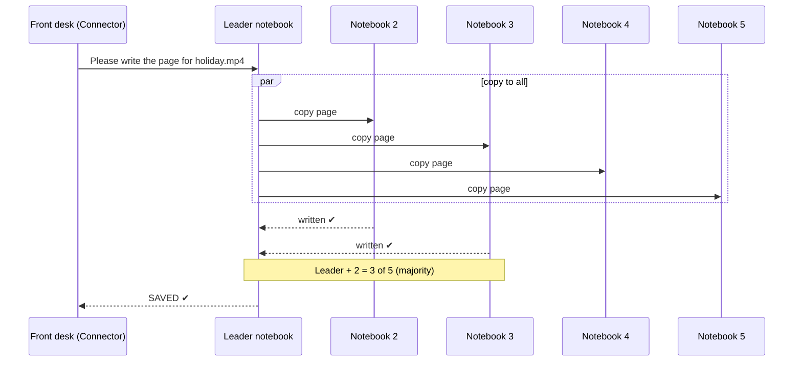

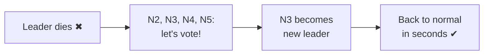

### Step 5: Why 5 notebooks and not 2 or 4?

Because of the **majority rule**:

| Notebooks | Majority needed | Can lose | Verdict |
| --- | --- | --- | --- |
| 2 | 2 | 0 | Bad: one fails and everything stops |
| 3 | 2 | 1 | OK for small setups |
| 4 | 3 | 1 | No better than 3, wastes a machine |
| **5** | **3** | **2** | **Best and most common** |

### Step 6: Order matters: pieces first, page second

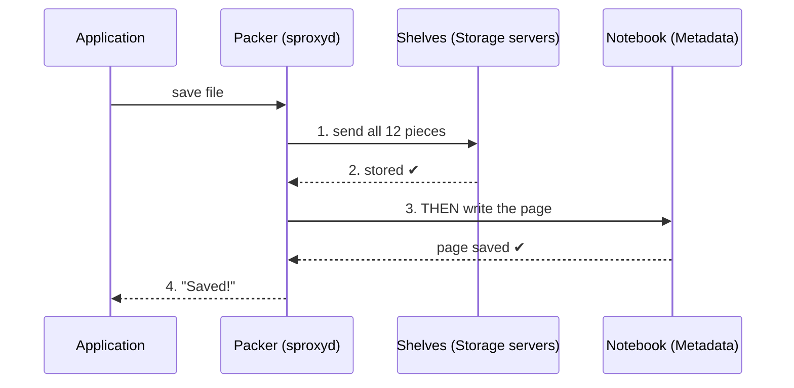

**Why this order?** Imagine the power goes off in the middle:

| If power cuts... | Result |
| --- | --- |
| After pieces, before page ✔ (correct order) | Some pieces with no page: harmless, cleaned later |
| After page, before pieces ✖ (wrong order) | Page points to pieces that **don't exist**: broken file |

So **the app never sees a broken file**.

### Step 7: The notebook makes "list my files" fast

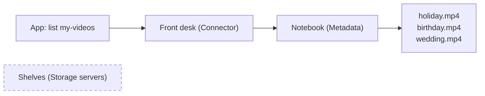

The shelves are **not touched at all**. Listing reads only the notebook.

### The full picture so far

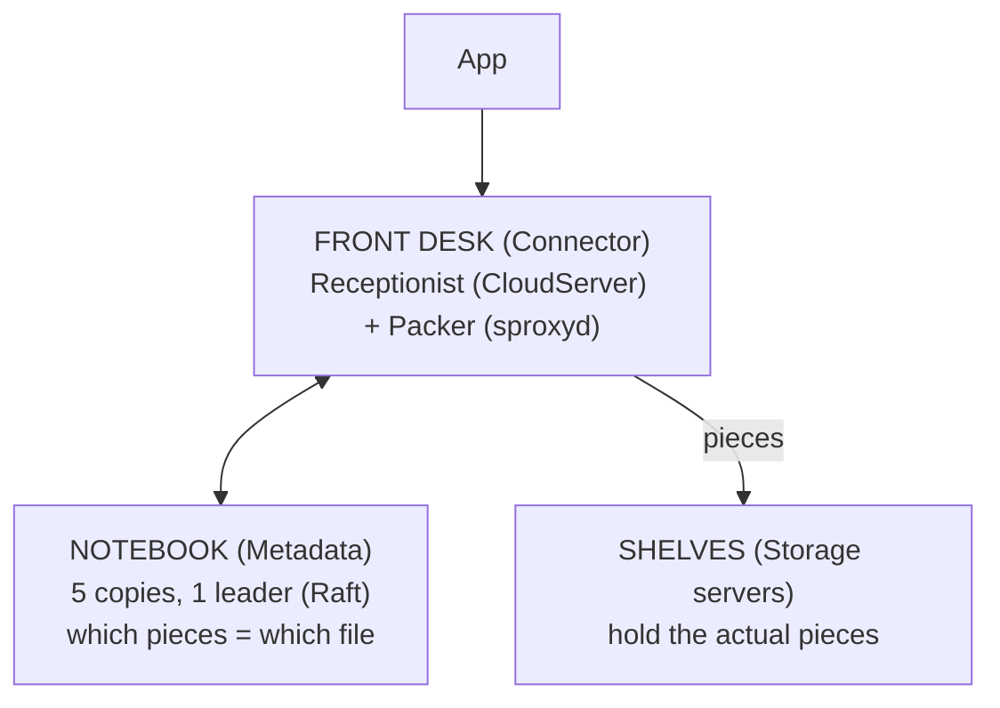

### Summary

1. The **Notebook (Metadata)** remembers which pieces make up each file.
2. It is kept on **5 notebook servers** with fast SSDs.
3. One **leader** writes, and a page is saved when **3 of 5 agree** (Raft).
4. If the leader dies, the others **vote** a new one in seconds.
5. **Pieces first, page second**, so a file is never broken.

---

## Lesson 4: Inside a Shelf (Storage server)

> **In one line:** Each **Shelf (Storage server)** runs about 6 **Chairs (Storage nodes)** that accept pieces, and one **Drawer keeper (IO daemon)** per disk that physically writes them.

### Step 1: A storage server is a big cabinet with many drawers

| Part | Everyday name | Job |
| --- | --- | --- |
| HDD (hard disk) | Big drawer | Holds the actual pieces: large, cheap, slower |
| SSD / NVMe | Small fast index-card box | Holds the lists of what is where: small, fast |
| CPU + memory | The workers' brains | Runs the software |
| Network cards | The door | Pieces come in and go out |

A typical server has **12 to 90 hard disks** of about 20 TB each.

### Step 2: Two kinds of workers inside

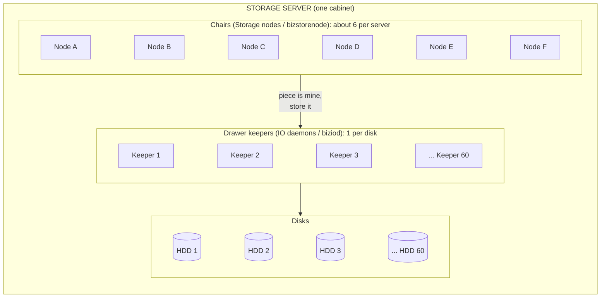

| Worker | Scality name | How many | Job |
| --- | --- | --- | --- |
| **Chair** | Storage node (`bizstorenode`) | ~6 per server | Owns a slice of the Round table (Ring); accepts pieces |
| **Drawer keeper** | IO daemon (`biziod`) | 1 per disk | Physically writes and reads pieces on its disk |

**Chairs decide. Drawer keepers do the physical work.**

> **Note:** this diagram shows where the storage nodes **physically run** (inside one server). It does **not** mean each server has its own round table. All storage nodes of **all** servers sit around **one single Round table (Ring)**. See Lesson 5, *"Does each server have its own round table?"*

### Step 3: Why ~6 chairs per server, not just 1?

**Think of what happens when a server dies:**

| Setup | When server S1 dies... |
| --- | --- |
| 1 big slice per server | **One neighbour** must take over all the work: overloaded and slow |
| 6 small slices per server | **Many servers** each take a small part: shared and fast |

It is like a team: if one person is sick, it's better if **everyone takes a little of their work** than if one person takes all of it.

### Step 4: Inside a drawer, pieces are packed in boxes (Containers)

A disk may hold **billions** of tiny pieces. Storing each as a separate file would make the disk **very slow**, like a drawer stuffed with loose paper slips. So the **Drawer keeper (IO daemon)** packs many pieces into **big boxes (Containers)**:

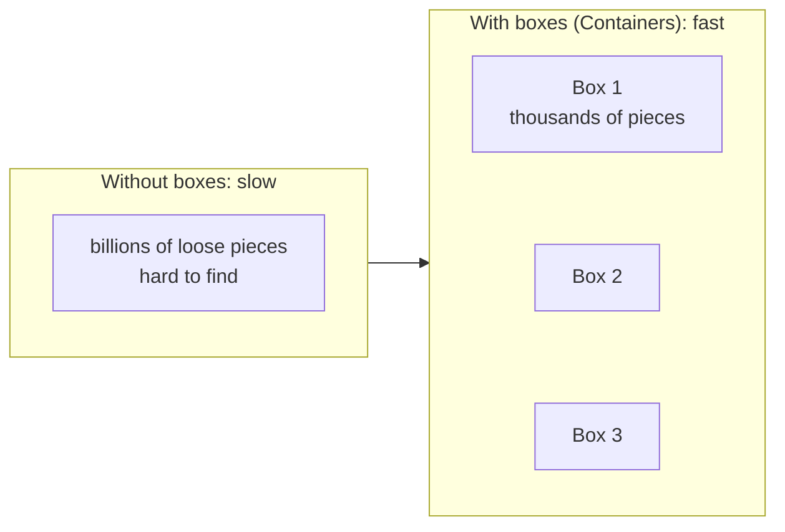

### Step 5: The index card (SSD index): finding a piece fast

The keeper keeps a **table of contents** on the **fast SSD**:

| Piece number (Ring key) | Box (Container) | Position in box |
| --- | --- | --- |
| 4821 | Box 17 | starts at 300 MB |
| 9930 | Box 3 | starts at 12 MB |
| 1177 | Box 17 | starts at 512 MB |

To read a piece:
1. Look it up in the **index on SSD**, which is very fast.
2. Jump **directly** to the right box and position on the HDD.

> A slow or small SSD makes **every** lookup slow. That's why SSDs matter so much.

### Step 6: Fingerprints (Checksums): catching damaged pieces

Over years, a disk can **silently damage** data. A few bits flip and nobody notices. This is called **bit rot**. So every piece is stored with a **fingerprint (Checksum)**, and a background **cleaner (Scrub)** checks them regularly:

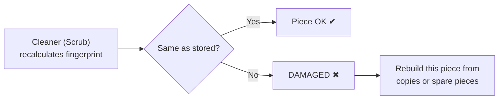

### Step 7: Journey of one piece inside a server

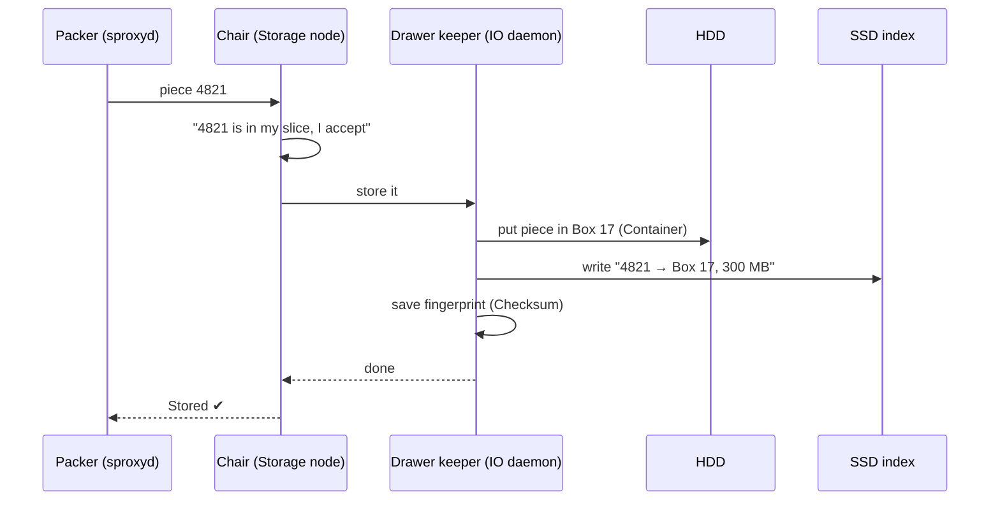

### Step 8: What if one disk inside the server dies?

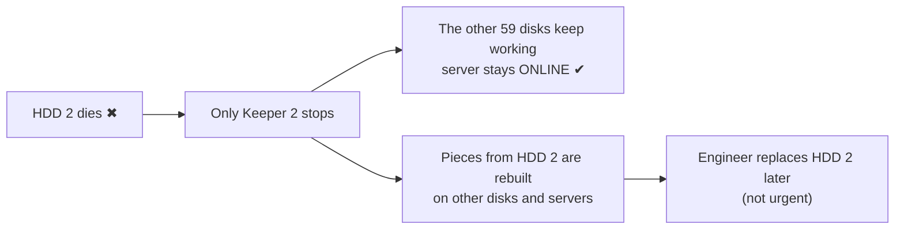

### Summary

1. A **Shelf (Storage server)** is a cabinet with many **HDD drawers** and a few **fast SSDs**.
2. **Chairs (Storage nodes)**, about 6 per server, own parts of the Round table (Ring).
3. **Drawer keepers (IO daemons)**, 1 per disk, do the actual reading and writing.
4. Pieces are **packed into boxes (Containers)** so disks stay fast.
5. The **index on SSD** finds any piece in one jump.
6. **Fingerprints (Checksums)** detect damage, and the **Cleaner (Scrub)** gets it repaired.

---

## Lesson 5: The Round table (Ring): how pieces are placed

> **In one line:** Servers sit around a **Round table (Ring)**, and pieces are **dealt like cards** so the pieces of one file **never end up together**.

This lesson is explained in **two ways**: first the **card-game story** (3 simple ideas), then the **numbers example**.

---

### Part A: The card-game story

#### Idea 1: Why spread pieces at all? (eggs and baskets)

You have **12 eggs**:

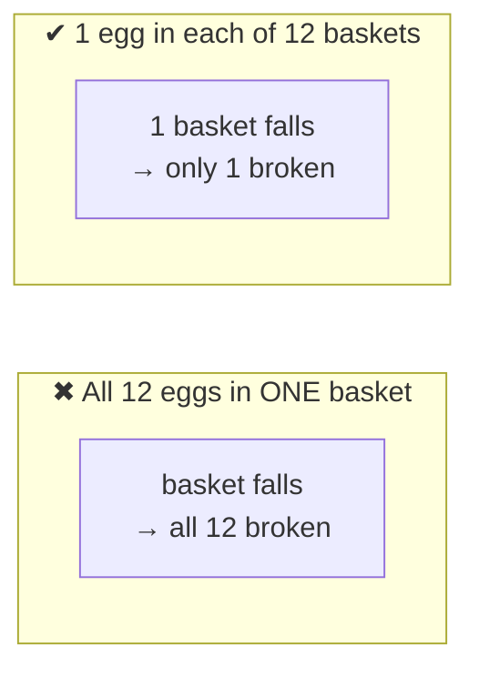

- **Egg** = one piece of the file
- **Basket** = one server

**The whole lesson is only this: never put all the pieces of one file in one place.**

#### Idea 2: Dealing the pieces like playing cards

**12 players** sit around a table, and **each player is a different server**. The **dealer** is the **Packer (sproxyd)**. It deals the 12 pieces around the table, **one card to each player**:

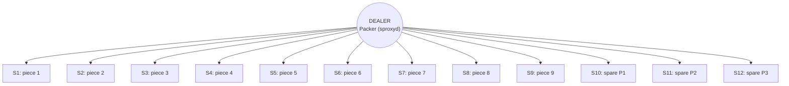

Result: **every server holds only ONE piece**. If one server dies, you lose only one piece, and you can lose up to 3.

**"The ring" is just this round table.** Servers sit around it, and pieces are dealt around it.

#### Idea 3: The seating must be planned correctly

**Problem 1: the same person in two neighbouring chairs.**

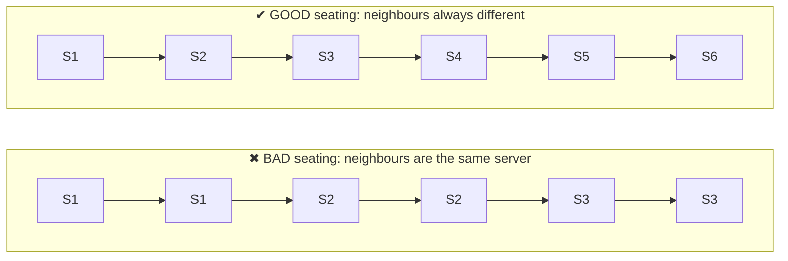

With bad seating, **S1 receives 2 cards of the same file**. If S1 fails, **2 pieces are lost at once**.

**Problem 2: players sitting in different rooms (Racks).** Servers live in **racks**, which are like rooms. 12 players in **3 rooms of 4**:

```mermaid
flowchart LR
    subgraph R1["ROOM 1 (Rack 1)"]
        s1["S1"] ~~~ s2["S2"] ~~~ s3["S3"] ~~~ s4["S4"]
    end
    subgraph R2["ROOM 2 (Rack 2)"]
        s5["S5"] ~~~ s6["S6"] ~~~ s7["S7"] ~~~ s8["S8"]
    end
    subgraph R3["ROOM 3 (Rack 3)"]
        s9["S9"] ~~~ s10["S10"] ~~~ s11["S11"] ~~~ s12["S12"]
    end
```

If the electricity in **Room 1 goes off**, **4 cards are lost**.

#### The only counting rule you need

The puzzle has **12 pieces**, and you need **any 9**. So you can lose **at most 3**.

| What breaks | Cards lost | Cards left | Enough (9)? |
| --- | --- | --- | --- |
| 1 server | 1 | 11 | ✔ Yes |
| 3 servers | 3 | 9 | ✔ Yes |
| 1 whole room (4 servers) | 4 | 8 | ✖ **No** |

**Fix:** use **4 rooms with 3 players each**. Then losing a room loses only 3 cards ✔.

> **Golden rule:** no server, rack or building may hold more pieces of one file than the number of **spare pieces (Parity fragments)**.

---

### Part B: Common questions (answered)

#### "Is the ring just a group of servers?"

**Mostly yes.** The word is used in two ways:

| Word | Meaning |
| --- | --- |
| **RING** (product name) | The whole cluster: the **group of servers** working together |
| **"the ring" / "the clock"** (inside) | The **round table** those servers sit around, used to decide who stores which piece |

**Clock = ring = round table.** They are the same thing.

#### "What is a slice owner / chair?"

| Everyday | Scality name | What it is |
| --- | --- | --- |
| **Person** | **Server** | A real, physical machine |
| **Chair** | **Storage node** (`bizstorenode`) | A software process on that machine |

**One person can sit in more than one chair**, like one person holding 2 seats in a game.

#### "2 chairs per server or 6? Which is right?"

| | Chairs per server | Why |
| --- | --- | --- |
| **Real Scality** | **About 6** | The real-life setting |
| **Examples in this guide** | **2** | Only to keep drawings small; the idea is the same |

#### "Does each server have its own round table?" (a common confusion)

**No.** This is the most important point of the whole lesson:

> **The server is NOT the round table.**
> **There is only ONE round table (Ring) for the whole cluster.**
> **All the chairs (Storage nodes) of all the servers sit around that same single table.**

| Thing | Everyday name | How many (6 servers × 6 nodes) |
| --- | --- | --- |
| **The whole cluster (RING)** | **The round table** | **Only ONE** |
| **Server** | **A person** | 6 |
| **Storage node** (`bizstorenode`) | **A chair** | 6 per person, so **36 in total** |

**✖ The wrong picture: one table per server**

```mermaid
flowchart LR
    subgraph T1["Table 1 = Server 1 ✖"]
        a1["node1"] ~~~ a2["node2"] ~~~ a3["... node6"]
    end
    subgraph T2["Table 2 = Server 2 ✖"]
        b1["node1"] ~~~ b2["node2"] ~~~ b3["... node6"]
    end
    subgraph T6["Table 6 = Server 6 ✖"]
        c1["node1"] ~~~ c2["node2"] ~~~ c3["... node6"]
    end
    T1 ~~~ T2 ~~~ T6
```

**✔ The correct picture: ONE table, 36 chairs, all servers mixed around it**

```
                    ONE ROUND TABLE (the RING)
                     36 chairs in total

            S1  S2  S3  S4  S5  S6  S1  S2  S3
         S6                                    S4
       S5                                        S5
       S4                                        S6
       S3              ONE TABLE                 S1
       S2           (whole cluster)              S2
       S1                                        S3
         S6                                    S4
            S5  S4  S3  S2  S1  S6  S5  S4  S3 ...

   Going around: S1, S2, S3, S4, S5, S6, S1, S2, S3 ... (36 chairs)
```

You can also read it as **6 laps** around the **same** table:

| Lap around the table | Chair order |
| --- | --- |
| Lap 1 | S1-node1 → S2-node1 → S3-node1 → S4-node1 → S5-node1 → S6-node1 |
| Lap 2 | S1-node2 → S2-node2 → S3-node2 → S4-node2 → S5-node2 → S6-node2 |
| Lap 3 | S1-node3 → S2-node3 → … → S6-node3 |
| Lap 4 | S1-node4 → … → S6-node4 |
| Lap 5 | S1-node5 → … → S6-node5 |
| Lap 6 | S1-node6 → … → S6-node6 → back to the start |

**Server S1 sits in 6 chairs**, one in each lap, so its chairs are **spread all around the table** and never next to each other.

```mermaid
flowchart LR
    L1["Lap 1<br/>S1 S2 S3 S4 S5 S6"] --> L2["Lap 2<br/>S1 S2 S3 S4 S5 S6"] --> L3["Lap 3<br/>S1 S2 S3 S4 S5 S6"]
    L3 --> L4["Lap 4<br/>S1 S2 S3 S4 S5 S6"] --> L5["Lap 5<br/>S1 S2 S3 S4 S5 S6"] --> L6["Lap 6<br/>S1 S2 S3 S4 S5 S6"]
    L6 -- "back to the start<br/>(it is a circle)" --> L1
```

##### Why the confusion happens: two views of the same thing

The diagram in **Lesson 4** shows 6 nodes **inside** a server box. That box shows **where the nodes physically run**. The round table shows **where the nodes logically sit**:

```
  VIEW 1: PHYSICAL (inside the machine)       VIEW 2: LOGICAL (the ring)

  ┌──── Server S1 ────┐                       ONE table, 36 chairs:
  │ node1 node2 node3 │   these 6 processes    S1-node1 sits in chair 1
  │ node4 node5 node6 │   run on S1's CPU      S1-node2 sits in chair 7
  └───────────────────┘                        S1-node3 sits in chair 13
                                               S1-node4 sits in chair 19
                                               S1-node5 sits in chair 25
                                               S1-node6 sits in chair 31
```

```mermaid
flowchart LR
    subgraph PHY["PHYSICAL VIEW: Server S1 (one machine)"]
        n1["node1"] ~~~ n2["node2"] ~~~ n3["node3"]
        n4["node4"] ~~~ n5["node5"] ~~~ n6["node6"]
    end
    subgraph LOG["LOGICAL VIEW: the ONE Round table (Ring)"]
        c1["chair 1"] ~~~ c7["chair 7"] ~~~ c13["chair 13"]
        c19["chair 19"] ~~~ c25["chair 25"] ~~~ c31["chair 31"]
    end
    n1 -- "sits in" --> c1
    n2 -- "sits in" --> c7
    n3 -- "sits in" --> c13
    n4 -- "sits in" --> c19
    n5 -- "sits in" --> c25
    n6 -- "sits in" --> c31
```

**Everyday example: one person who bought 6 seats in the same cinema hall.**
- **Physically**, it is **one person** (one server).
- **In the hall**, they hold **6 seats** (6 storage nodes) in **different rows**.
- **There is only one cinema hall** (one ring), shared by everyone.

##### The example, answered

> "I have 6 servers and each server has 6 storage nodes."

| Question | Answer |
| --- | --- |
| How many round tables? | **1** (the whole cluster) |
| How many chairs at that table? | **6 × 6 = 36** |
| How many chairs does S1 own? | **6**, spread around the table (one per lap) |
| Who stores a piece? | The **chair** after the piece's **Ticket number (Ring key)**, and whichever server owns that chair |

> **Remember:** **one cluster = one round table.** **Server = person, storage node = chair.** Each server owns **about 6 chairs** at the **same** table, spread **far apart**.

#### "But you said one person in two chairs is bad?"

| Seating | Good or bad? |
| --- | --- |
| S1 in chair 10 **and chair 20** (next to each other) | ✖ **Bad**: S1 can get 2 cards of the same file |
| S1 in chair 10 **and chair 70** (far apart) | ✔ **Good**: S1's chairs never get cards from the same file |

**Several chairs per server is fine, as long as they are far apart.** Scality's planning tool guarantees this.

#### "Why give a server several chairs at all?"

1. **Fair sharing, like cutting a cake.** 36 small slices share out more evenly than 6 big ones.
2. **Easy to grow.** A new server takes **a little work from many servers**, instead of a big chunk from one.

#### "Where is the ring kept?"

The ring is **not a machine** and **not a place**. **The ring is a seating plan: a list.** **Everybody has a copy**, like a printed seating chart handed to every wedding guest:

```mermaid
flowchart TB
    PLAN["SEATING PLAN = the ring<br/>(Key assignment / ring topology)<br/>Chair 10 → S1 · Chair 20 → S2 · ..."]
    PLAN --> N["Every Chair (Storage node)<br/>knows its neighbours"]
    PLAN --> C["Every Front desk (Connector)<br/>keeps it as a Map"]
    PLAN --> SUP["Manager's office (Supervisor)<br/>displays and manages it"]
```

---

### Part C: The numbers example (how a piece finds its server)

The real ring has a gigantic number of positions (2^160). For learning, we use **chairs numbered 10 to 120**.

**6 servers (S1–S6) × 2 chairs = 12 chairs**, seated so neighbours are always different:

```
                       Chair 120: S6
            Chair 110: S5          Chair 10: S1
        Chair 100: S4                  Chair 20: S2
       Chair 90: S3     ROUND TABLE      Chair 30: S3
        Chair 80: S2       (Ring)      Chair 40: S4
            Chair 70: S1           Chair 50: S5
                       Chair 60: S6
```

| Chair | 10 | 20 | 30 | 40 | 50 | 60 | 70 | 80 | 90 | 100 | 110 | 120 |
| --- | --- | --- | --- | --- | --- | --- | --- | --- | --- | --- | --- | --- |
| Server | S1 | S2 | S3 | S4 | S5 | S6 | S1 | S2 | S3 | S4 | S5 | S6 |

S1 sits in chairs **10 and 70**, on **opposite sides** of the table. The same holds for every server.

#### The "walk clockwise" rule

Every piece gets a **Ticket number (Ring key)**, which looks random, like a lottery ticket, so pieces spread **evenly**.

> **Rule:** start at the ticket number and walk clockwise to the **first chair**. Whoever sits there stores the piece.

```mermaid
flowchart LR
    T["Piece ticket 37"] --> W["walk clockwise<br/>38 → 39 → 40"] --> CH["Chair 40"] --> S["S4 stores it ✔"]
```

| Ticket number | Next chair | Stored by |
| --- | --- | --- |
| 5 | 10 | S1 |
| 37 | 40 | S4 |
| 65 | 70 | S1 |
| 115 | 120 | S6 |

**No list, no searching. The number alone tells you the server.**

#### Spreading copies: jumping around the table

3 copies → jump = 120 ÷ 3 = **40**:

```mermaid
flowchart LR
    K["Ticket 37"] --> C1["Copy 1: 37 → chair 40 → S4"]
    K --> C2["Copy 2: 37+40 = 77 → chair 80 → S2"]
    K --> C3["Copy 3: 77+40 = 117 → chair 120 → S6"]
    C1 & C2 & C3 --> R["3 different servers ✔"]
```

For **12 puzzle pieces** it's the same, with smaller jumps (120 ÷ 12 = 10), so each piece lands on a different server.

#### Layers of safety

The seating plan is made in **layers**, biggest danger first:

```mermaid
flowchart LR
    L1["1. Different BUILDINGS<br/>(Sites)"] --> L2["2. Different RACKS"] --> L3["3. Different SERVERS"] --> L4["4. Different DISKS"]
```

#### The Map: one-jump delivery

```mermaid
flowchart LR
    subgraph NOMAP["Without map: ask for directions (Chord)"]
        P1["Packer"] --> A1["S1"] --> A2["S3"] --> A3["S4"]
    end
    subgraph MAP["With map (cached ring topology): what RING does"]
        P2["Packer (sproxyd)"] -- "one hop" --> B1["S4 ✔"]
    end
```

If the seating plan changes (a server is added or fails), every map is **updated automatically**.

---

### Part D: Checking your understanding

The full journey of a piece, corrected:

```mermaid
flowchart TB
    FD["Front desk: Packer (sproxyd)<br/>looks at its Map:<br/>piece 37 → chair 40 → S4"] -- "sends DIRECTLY" --> SRV
    subgraph SRV["Server S4"]
        SN["Chair 40 (Storage node):<br/>OK, I accept piece 37"] --> IO["Drawer keeper (IO daemon)"]
        IO --> HDD[("HDD: the piece itself")]
        IO --> SSD[("SSD: the address<br/>37 → HDD 12, box 17")]
    end
```

| Statement | Correct? |
| --- | --- |
| The front desk breaks the file and numbers the pieces | ✔ |
| The server is asked "is this yours?" | ✖ The front desk **already knows** from its Map and sends directly |
| The storage node accepts the piece; the IO daemon writes it | ✔ |
| The piece goes on HDD **or SSD** | ✖ The **piece goes on HDD**; the **SSD keeps only the address** |
| The ring is arranged so pieces of one file never share a server | ✔ |

### Summary

1. **Don't put all eggs in one basket**: each piece goes to a different server.
2. **RING** = the group of servers sitting around a **Round table (Ring)**.
3. **Chair = Storage node, Person = Server.** About 6 chairs per server, **far apart**.
4. A piece goes to the **next chair after its Ticket number (Ring key)**.
5. The **Seating plan (Key assignment)** keeps pieces on different servers, racks and sites.
6. The Packer carries a **Map**, so each piece goes there in **one hop**.

---

# Part 2: Operations

---

## Lesson 6: When a server dies (Self-healing)

> **In one line:** A dead server is noticed in seconds, users keep working, and the lost pieces are **rebuilt automatically by all the other servers**.

Story: **12 players** at the card table, each holding 1 piece. Suddenly **player S4 faints and leaves.**

### Step 1: Everyone notices (Heartbeat)

```mermaid
sequenceDiagram
    participant S3 as S3
    participant S4 as S4 (dead)
    participant S5 as S5
    participant SUP as Supervisor
    S3->>S4: are you alive? (Heartbeat)
    Note right of S4: no answer
    S5->>S4: are you alive?
    Note right of S4: no answer
    S3->>SUP: S4 is DOWN
    SUP->>SUP: S4 turns red + alert to engineers
```

### Step 2: Reading still works (users notice nothing)

```mermaid
flowchart LR
    R["App asks for a file<br/>with a piece on S4"] --> Q{"Small or big file?"}
    Q -- "Small (3 copies)" --> A["Copy on S4 ✖<br/>→ use copy on S2 ✔"]
    Q -- "Big (12 pieces)" --> B["11 pieces left<br/>→ take any 9<br/>→ rebuild the file ✔"]
```

This is called a **degraded read**. The app gets its file normally.

### Step 3: Saving new files still works

New pieces meant for S4's chairs go to **the next chair** around the table for now (chair 40 → chair 50, S5).

### Step 4: Wait a little, because S4 may come back

| Case | What happens |
| --- | --- |
| S4 comes **back quickly** (reboot, cable) | It **catches up** on what it missed: quick and easy |
| S4 does **not** come back | Go to Step 5: **Rebuild** |

Why wait? Rebuild is **heavy work**. Doing it for a 2-minute reboot would be a waste.

### Step 5: Rebuild: recreate the lost pieces

```mermaid
flowchart LR
    subgraph SMALL["Small files"]
        C["Surviving copy on S2"] -- "copy" --> N1["New copy on S6 ✔<br/>back to 3 copies"]
    end
    subgraph BIGF["Big files"]
        G["Take 9 good pieces"] -- "calculate" --> NP["Missing piece made again"] --> ST["Stored on a healthy server ✔<br/>back to 12 pieces"]
    end
```

**Why rebuild is fast: everyone helps.** S4 held thousands of pieces, and **all other servers share the work at the same time**:

```mermaid
flowchart LR
    S1["S1 rebuilds some"] --> DONE["All of S4's pieces<br/>recreated quickly ✔"]
    S2["S2 rebuilds some"] --> DONE
    S3["S3 rebuilds some"] --> DONE
    S5["S5 rebuilds some"] --> DONE
    S6["S6 rebuilds some"] --> DONE
```

It's like a classmate losing their notebook: the **whole class** each rewrites a few pages, and it's done in minutes.

### Step 6: The engineer fixes the server, and it rejoins

1. The server is repaired or replaced. It's **not urgent**, because data is already safe.
2. It sits back in its chairs.
3. RING slowly moves some pieces back to it, so all servers are equally full (**Balance**).

### The whole story

```mermaid
stateDiagram-v2
    state "Healthy" as H
    state "Server down (noticed by Heartbeat)" as D
    state "Waiting (maybe a reboot)" as W
    state "Rebuild (all servers help)" as R
    state "Data fully protected again" as P
    state "Server repaired + Balance" as B
    [*] --> H
    H --> D: server fails
    D --> W
    W --> H: server returns quickly, catches up
    W --> R: timeout passed
    R --> P
    P --> B: engineer fixes hardware
    B --> H
```

> **During the whole story: reading ✔ and saving ✔. No downtime.**

### Why "never fill more than 80%" matters

```mermaid
flowchart LR
    A["Cluster 80% full"] --> A2["enough empty space<br/>→ rebuild finishes ✔"]
    B["Cluster 98% full"] --> B2["no space left<br/>→ rebuild STUCK ✖"]
```

It's like a hotel: if one floor floods, guests move to **empty rooms**. A 100% full hotel has nowhere to put them.

### Summary

1. **Heartbeat:** servers notice a dead one in seconds.
2. **Reading still works** from other copies or 9 of the remaining pieces.
3. **Saving still works**, because the next chair takes over.
4. **Wait a little**, because it might just be a reboot.
5. **Rebuild:** lost pieces are made again, and **everyone helps**, so it's fast.
6. Stay **≤ 80% full**, so there is room to rebuild.

---

## Lesson 7: Adding servers (Expansion and Balance)

> **In one line:** New servers get **new chairs between the old ones**. **Only the nearby pieces move**, slowly, in the background, with no downtime.

### Step 1: When do we add servers?

| Reason | Example |
| --- | --- |
| **Running out of space** | Cluster is **70–75% full**, so add before 80% |
| **Need more speed** | More users: more servers = more disks and workers |

```mermaid
flowchart LR
    A["70% full<br/>ORDER servers"] --> B["75%<br/>INSTALL them"] --> C["80%<br/>DANGER LINE<br/>never cross"]
    style C fill:#f9dede,stroke:#d64545
```

Buying and installing takes **weeks**, so plan early.

### Step 2: Prepare the new servers

1. Buy servers, **ideally the same model and disk size**.
2. Put them in racks **evenly**, e.g. 1 new server per rack.
3. Install the Scality software.

They are **standing next to the table, not sitting yet**.

### Step 3: Give them chairs (update the Seating plan)

**Before:** 6 servers × 2 chairs. **New server S7** arrives with 2 chairs, placed at **35 and 95**:

```
  Chair:  10   20   30  [35]  40   50   60   70   80   90  [95]  100  110  120
  Owner:  S1   S2   S3  [S7]  S4   S5   S6   S1   S2   S3  [S7]  S4   S5   S6
                         NEW                                NEW
```

### Step 4: Which pieces move? Only a few

```mermaid
flowchart LR
    T["Piece ticket 33"] --> B["BEFORE: next chair 40 → S4"]
    T --> A["AFTER: next chair 35 → S7"]
    A --> M["moves S4 → S7"]
```

| Pieces with tickets | Before | After | Moves? |
| --- | --- | --- | --- |
| 31–35 | S4 | **S7** | ✔ |
| 36–40 | S4 | S4 | ✖ |
| 91–95 | S4 | **S7** | ✔ |
| **Everything else** | same | same | ✖ |

> **Why this is clever:** a bad system would "renumber every house in the city". RING lets the new house take a few numbers from its **neighbour only**.

### Step 5: Move pieces slowly in the background (Balance)

```mermaid
sequenceDiagram
    participant S4 as S4 (old owner)
    participant S7 as S7 (new server)
    participant App as Users
    loop slowly, step by step (throttled)
        S4->>S7: move piece 31, 32, 33 ...
    end
    App->>S4: read piece 33 during the move
    S4-->>App: still served from old place ✔
    Note over S4,S7: When finished, S7 owns tickets 31–35 and 91–95
```

| Question | Answer |
| --- | --- |
| Does the cluster stop? | ✖ **No**, users keep working |
| Is it fast? | **Slow on purpose** (throttled), so users feel nothing; faster at night if wanted |
| Read during a move? | Found in the **old place** until the move finishes |
| Who gets the new seating plan? | **Everyone**: every server and every front desk Map |

### Step 6: Result

```
  BEFORE:  6 servers  →  75% full
  AFTER:   7 servers  →  ~64% full   + more speed (more disks, more workers)
```

### Rules for adding servers

```mermaid
flowchart TB
    subgraph G["✔ GOOD: add 1 server to each rack"]
        g1["Rack 1: 4 → 5"] ~~~ g2["Rack 2: 4 → 5"] ~~~ g3["Rack 3: 4 → 5"]
    end
    subgraph BD["✖ BAD: add 3 servers to one rack"]
        b1["Rack 1: 4 → 7<br/>too many pieces here"] ~~~ b2["Rack 2: 4"] ~~~ b3["Rack 3: 4"]
    end
```

| Rule | Why |
| --- | --- |
| 1. Add **evenly across racks** | Keeps the golden rule safe |
| 2. Use **similar servers and disks** | Keeps the seating plan simple and fair |
| 3. **Plan early** (order at ~70%) | Installed before 80% |

### Removing an old server (the opposite)

```mermaid
flowchart LR
    A["1. Tell RING:<br/>S2 will leave"] --> B["2. Move S2's pieces<br/>to others (Balance)"] --> C["3. S2 EMPTY →<br/>remove its chairs"] --> D["4. Switch off ✔"]
```

> **Never switch a server off before it is empty.** Otherwise RING treats it as a failure and rebuilds.

### Summary

1. Add servers at **~70% full**.
2. New servers get **new chairs between existing chairs**.
3. **Only pieces next to the new chairs move.**
4. **Balance** moves them **slowly in the background**, with no downtime.
5. Add **evenly across racks**.
6. To remove a server: **empty it first**.

---

# Part 3: Infrastructure

---

## Lesson 8: Multiple buildings (Multi-site)

> **In one line:** To survive a disaster to a **whole building (Site)**, either stretch one cluster over **3 nearby buildings (Stretched RING)** or **copy data to a far city (Asynchronous replication)**.

### Step 1: The problem: one building is one big basket

```mermaid
flowchart LR
    subgraph B["ONE BUILDING (Site)"]
        R1["Rack 1"] ~~~ R2["Rack 2"] ~~~ R3["Rack 3"] ~~~ R4["Rack 4"]
    end
    DIS["Fire / flood /<br/>city power cut"] --> B
    B --> L["EVERYTHING gone ✖<br/>even with perfect racks"]
```

There are **two ways** to solve this:

| Way | Simple idea | Scality name |
| --- | --- | --- |
| **A** | **One big table stretched across 3 buildings** | Stretched RING (synchronous) |
| **B** | **Two separate tables; a copy is sent later** | Asynchronous replication (Backbeat / CRR) |

---

### WAY A: One table stretched across 3 buildings

#### Step 2: Seat the players in 3 buildings

```mermaid
flowchart LR
    A["BUILDING A<br/>4 pieces"] <-->|"fast cables"| B["BUILDING B<br/>4 pieces"]
    B <-->|"fast cables"| C["BUILDING C<br/>4 pieces"]
    A <-->|"fast cables"| C
```

It is still **ONE cluster**. Each file's 12 pieces are split **4 + 4 + 4**.

#### Step 3: The puzzle must change (ARC 7+5)

With the normal puzzle **9 + 3**, losing a building (4 pieces) leaves **8**, but we need 9 ✖. So stretched clusters use **7 normal + 5 spare = 12 pieces**, and need **any 7**:

| Puzzle | Pieces | Need | Lose 1 building (4 pieces) | Extra space |
| --- | --- | --- | --- | --- |
| 9 + 3 (ARC 9+3) | 12 | 9 | ✖ Lost | ~1.33× |
| **7 + 5 (ARC 7+5)** | 12 | 7 | ✔ **Safe** (8 left), even with 1 more disk failure | ~1.7× |

**The price:** more spare pieces means more space. Safety costs some disk space.

#### Step 4: The Notebook (Metadata) is spread 2 / 2 / 1

```mermaid
flowchart LR
    subgraph A["Building A"]
        a1["Notebook"] ~~~ a2["Notebook"]
    end
    subgraph B["Building B"]
        b1["Notebook"] ~~~ b2["Notebook"]
    end
    subgraph C["Building C"]
        c1["Notebook"]
    end
```

| Building lost | Notebooks left | Majority (3)? |
| --- | --- | --- |
| A (2) | 3 | ✔ |
| B (2) | 3 | ✔ |
| C (1) | 4 | ✔ |

> Putting **3** notebooks in one building would be a mistake: if it burns, **2** remain, which is not a majority, and **everything stops**.

#### Step 5: The distance limit

In Way A, the front desk says **"Saved!" only after all buildings stored their pieces**:

```mermaid
sequenceDiagram
    participant App
    participant FD as Front desk (Connector)
    participant A as Building A
    participant B as Building B
    participant C as Building C
    App->>FD: save file
    par every save waits for ALL buildings
        FD->>A: 4 pieces
        FD->>B: 4 pieces
        FD->>C: 4 pieces
    end
    A-->>FD: ✔
    B-->>FD: ✔
    C-->>FD: ✔
    FD-->>App: Saved! (only now)
```

| Buildings | Travel time | Saving feels |
| --- | --- | --- |
| Same city (e.g. 20 km) | A few milliseconds | Fast ✔ |
| Different countries (e.g. 1500 km) | Long | Too slow ✖ |

It's like a conversation: easy in one room, but painful if every sentence takes 5 seconds to arrive.

> **Way A works only for nearby buildings ("metro distance").**

---

### WAY B: Two separate clusters, copy sent later

#### Step 6: How it works

```mermaid
sequenceDiagram
    participant App
    participant C1 as CITY 1: RING cluster 1
    participant BB as Courier (Backbeat)
    participant C2 as CITY 2: RING cluster 2
    App->>C1: save file
    C1-->>App: Saved! (immediately)
    C1->>BB: queue a copy
    BB->>C2: deliver copy (seconds to minutes later)
```

It's like **posting a photocopy of a letter**: you keep the original, and the copy arrives at the other office later.

#### Step 7: The small risk

```
  10:00:00 saved → copied ✔
  10:00:05 saved → copied ✔
  10:00:09 saved → still with the Courier ... CITY 1 destroyed
           → this last file is LOST ✖ (only the last seconds or minutes)
```

---

### Step 8: Two important words: RPO and RTO

| Word | Simple question | Way A (Stretched) | Way B (Async) |
| --- | --- | --- | --- |
| **RPO** | "How much **data** can we lose?" | **Zero** | Last seconds or minutes |
| **RTO** | "How long until it **works again**?" | Almost instantly (automatic) | Minutes to hours (switch-over) |

### Step 9: Only 2 buildings? Add a Referee site (Witness)

With 5 notebooks split **3 + 2**, losing the building with 3 leaves only 2: no majority ✖. **Solution:** a **tiny third place** that holds **only a notebook, no data**, like a referee who breaks ties:

```mermaid
flowchart LR
    A["BUILDING A<br/>data + 2 Notebooks"] <--> B["BUILDING B<br/>data + 2 Notebooks"]
    A <--> W["Referee site (Witness)<br/>1 Notebook only, no data"]
    B <--> W
```

Any one place can fail and **3 notebooks remain** ✔. The exact 2-building design depends on the Scality version.

### Step 10: Big companies use BOTH

```mermaid
flowchart LR
    subgraph CITY1["CITY 1: Stretched RING (RPO = 0)"]
        A["Building A"] <--> B["Building B"] <--> C["Building C"]
    end
    CITY1 -- "Courier (Backbeat)<br/>async copy" --> DR["CITY 2 (far away)<br/>RING cluster 2"]
```

| Disaster | Who saves you |
| --- | --- |
| One building lost | Way A: zero data loss |
| Whole city lost | Way B: tiny data loss |

### Step 11: How to choose

```mermaid
flowchart TD
    Q1{"Need protection from a<br/>building disaster?"}
    Q1 -- "No" --> ONE["One building<br/>(cheapest)"]
    Q1 -- "Yes" --> Q2{"Buildings in the SAME city?"}
    Q2 -- "Yes" --> A["Way A: Stretched across 3 buildings<br/>(or 2 buildings + Witness)"]
    Q2 -- "No" --> B["Way B: Async replication"]
    A --> Q3{"Very critical business?"}
    B --> Q3
    Q3 -- "Yes" --> BOTH["Use BOTH"]
```

### Summary

1. **One building = one basket.**
2. **Way A (Stretched):** one cluster across **3 nearby buildings**, pieces split 4 + 4 + 4.
3. Way A uses the **7 + 5 puzzle (ARC 7+5)**.
4. **Notebooks split 2 / 2 / 1**, so the vote survives any building loss.
5. Way A needs buildings **close together**.
6. **Way B (Async):** any distance, may lose the **last few minutes**.
7. **2 buildings only?** Add a **Referee site (Witness)**.

---

## Lesson 9: The network

> **In one line:** All servers talk over **three separate roads (networks)**, and **everything is doubled**, so no single cable or switch can stop the cluster.

### Step 1: Why the network matters

Every action **travels on the network**:

| Action | Travels from → to |
| --- | --- |
| App saves a file | App → Front desk (Connector) |
| Packer sends 12 pieces | Connector → 12 servers |
| Writing the Notebook page | Connector → Metadata servers |
| Heartbeat | Server ↔ server |
| Rebuild after a failure | Server ↔ server (**lots of data**) |
| Balance after adding servers | Server → new server (**lots of data**) |
| Engineer checks the system | Engineer → Supervisor |

**If the roads are bad, everything is slow, even with the best servers.**

### Step 2: Three separate roads

Think of a **hospital**: a patients' entrance, staff-only corridors, and an admin corridor that needs a key card.

```mermaid
flowchart TB
    APPS["Applications (customers)"] --> FE["CUSTOMER ROAD<br/>(Front-end network)"]
    FE --> CON["Front desks (Connectors)"]
    CON --> BE["WAREHOUSE ROAD<br/>(Back-end network)"]
    BE --> SRV["Storage servers S1 … S6"]
    MG["STAFF ROAD<br/>(Management network)"] -.-> SRV
    MG -.-> CON
    ADM["Supervisor + engineers + monitoring"] --> MG
```

| Road (Scality name) | Who uses it | Hospital example |
| --- | --- | --- |
| Customer road (Front-end network) | Apps ↔ connectors | Patients' entrance |
| Warehouse road (Back-end network) | Connectors ↔ servers, server ↔ server | Staff-only corridors |
| Staff road (Management network) | Engineers, Supervisor, monitoring | Admin corridor |

**Why not one road for everything?**

| Reason | Explanation |
| --- | --- |
| **Traffic jams** | Rebuild sends huge data between servers; customers on the same road would be stuck |
| **Security** | Customers can **never even see** the staff road |

### Step 3: The Warehouse road (Back-end) is the busiest

The packer turns **one file into many pieces**:

```mermaid
flowchart LR
    A["App sends 90 MB<br/>(Customer road)"] --> P["Packer (sproxyd)<br/>9 + 3 = 12 pieces × 10 MB"]
    P --> B["120 MB on the<br/>Warehouse road"]
    P2["Small files:<br/>3 copies"] --> B2["3 × the size"]
```

Rebuild and Balance also use this road.

> **Rule: the Warehouse road must be bigger (faster) than the Customer road.**

### Step 4: Road size: speed and lanes

| Speed | Highway example | Used for |
| --- | --- | --- |
| 1 Gb | Village road | Staff road (Management) |
| 25 Gb | City highway | Small or medium clusters |
| 100 Gb | Motorway | Modern clusters |

**Two cables per server (Bonding / LACP):**

```mermaid
flowchart LR
    S["Server S1"] == "cable 1" ==> SA["Switch A"]
    S == "cable 2" ==> SB["Switch B"]
```

| Situation | Result |
| --- | --- |
| Normal day | Both cables work: **double speed** |
| Cable 1 breaks | Cable 2 works: **server stays online** |

It's like a house with **two doors**.

### Step 5: Switches: the post offices of the network

- **Level 1: rack post office (Leaf / Top-of-Rack switch).** 2 per rack, on top.
- **Level 2: main post office (Spine switch).** Connects all racks.

```mermaid
flowchart TB
    SP1["SPINE 1"] --- L1["Leaf A+B<br/>Rack 1"]
    SP1 --- L2["Leaf A+B<br/>Rack 2"]
    SP1 --- L3["Leaf A+B<br/>Rack 3"]
    SP2["SPINE 2"] --- L1
    SP2 --- L2
    SP2 --- L3
    L1 --- R1["S1 – S4"]
    L2 --- R2["S5 – S8"]
    L3 --- R3["S9 – S12"]
```

This design is called **leaf-spine**:
- Any server reaches any other in **a few hops**.
- **Everything is doubled** (2 leaf, 2 spine).
- **Easy to grow**: a new rack just connects to the spines.

### Step 6: The Gate guard (Load balancer)

There are several front desks. A **load balancer** sends each app to a healthy one:

```mermaid
flowchart TB
    APPS["Apps → s3.company.com<br/>(VIP: one shared address)"] --> LB1["Load balancer 1<br/>(active)"]
    APPS -.-> LB2["Load balancer 2<br/>(standby)"]
    LB1 --> D1["Connector 1"]
    LB1 --> D2["Connector 2"]
    LB1 --> D3["Connector 3"]
```

| Situation | What happens |
| --- | --- |
| Connector 2 dies | The load balancer stops sending people there |
| Load balancer 1 dies | Load balancer 2 takes over the **same address (VIP)**; apps notice nothing |

It's like a shop phone number: the number stays the same, but someone else answers.

### Step 7: Big trucks (Jumbo frames, MTU 9000): a classic trap

```mermaid
flowchart LR
    subgraph OK["✔ All devices allow big trucks"]
        S1["Server"] == "MTU 9000" ==> W1["Switch A"] == "MTU 9000" ==> W2["Switch B"] == "MTU 9000" ==> S2["Server"]
    end
    subgraph TRAP["✖ One switch set to small trucks"]
        S3["Server"] == "MTU 9000" ==> W3["Switch A"] == "MTU 9000" ==> W4["Switch B<br/>MTU 1500 only"] -. "truck stuck / dropped" .-> S4["Server"]
    end
```

Big trucks carry about **6× more per trip** (faster), but **every device on the path** must allow them. One wrong switch causes **strange slowness and random errors**, one of the most common real-life problems.

### Step 8: Roads between buildings (stretched clusters)

| Need | Why |
| --- | --- |
| **Fast** links | Pieces travel between buildings constantly |
| **Short delay** (a few ms) | Every save waits for all buildings |
| **Two different cable paths** | If one cable is cut, the other works |

### Step 9: The full picture

```mermaid
flowchart TB
    U["APPS / USERS"] --> FE["CUSTOMER ROAD (Front-end)"]
    FE --> LB["Load balancer pair (VIP)"]
    LB --> C1["Connector 1"] & C2["Connector 2"] & C3["Connector 3"]
    C1 & C2 & C3 --> BE["WAREHOUSE ROAD (Back-end · 100 Gb · MTU 9000)"]
    BE --> SP1["Spine 1"] & SP2["Spine 2"]
    SP1 & SP2 --> LF1["Leaf A+B · Rack 1"] & LF2["Leaf A+B · Rack 2"] & LF3["Leaf A+B · Rack 3"]
    LF1 --> RK1["S1–S4"]
    LF2 --> RK2["S5–S8"]
    LF3 --> RK3["S9–S12"]
    MG["STAFF ROAD (Management)<br/>Supervisor · monitoring · engineers"] -.-> RK1 & RK2 & RK3
```

### Summary

1. The **network = roads**: bad roads make everything slow.
2. **3 separate roads** (Front-end, Back-end, Management) for **speed** and **security**.
3. The **Back-end is the busiest**.
4. **2 cables per server**, **2 switches per rack**.
5. **Leaf-spine**: every server is close to every other.
6. **Load balancer pair** with one shared address (**VIP**).
7. **Jumbo frames** must be set **everywhere**.

---

# Part 4: S3 in depth

---

## Lesson 10: How applications talk to RING (S3)

> **In one line:** Applications speak **S3**, a common storage language. The **Security office (Vault)** checks every request, **Versioning** keeps old copies, and the **Locked glass box (Object Lock)** protects backups from ransomware.

### Step 1: What is S3? A common language

S3 is a **set of rules** for saving and reading files over the network. Amazon invented it, and **almost every storage product speaks it**, including Scality. Think of **English at an international airport**.

```mermaid
flowchart LR
    V["Backup app (Veeam)"] --> S3L["speaks S3"]
    VA["Video app"] --> S3L
    AN["Analytics app"] --> S3L
    S3L --> AWS["Amazon cloud ✔"]
    S3L --> RING["Scality RING ✔<br/>same language"]
```

**Benefit:** any app that works with Amazon works with Scality. You just change the address.

### Step 2: The basic words

| S3 word | Simple meaning | Example |
| --- | --- | --- |
| **Endpoint** | The **address** of the front desk | `https://s3.company.com` |
| **Bucket** | A big **cupboard** for files | `veeam-backups` |
| **Object** | A **file + its information** | `holiday.mp4` + size, date, owner |
| **Object key** | The **file's name** in the bucket | `videos/2026/holiday.mp4` |

```mermaid
flowchart TB
    E["Endpoint: s3.company.com"] --> B1["Cupboard (Bucket): veeam-backups"]
    E --> B2["Cupboard (Bucket): hr-documents"]
    B1 --> O1["Object: server1/backup-mon.vbk"]
    B1 --> O2["Object: server1/backup-tue.vbk"]
    B2 --> O3["Object: contracts/ravi.pdf"]
```

> **Don't confuse the two "keys":** the **Object key** is the file name, which users see. The **Ring key** is a piece's ticket number, used only inside RING. The **Notebook (Metadata)** links them: `holiday.mp4` → tickets 37, 77, 117 …

### Step 3: Who are you? (Users and keys in Vault)

```mermaid
flowchart TB
    ACC["ACCOUNT (department)<br/>e.g. Backup Team"] --> U1["USER: veeam-server"]
    ACC --> U2["USER: ravi"]
    U1 --> K1["Access key (ID card)<br/>+ Secret key (PIN)"]
    U2 --> K2["Access key (ID card)<br/>+ Secret key (PIN)"]
```

| Thing | Simple meaning |
| --- | --- |
| **Access key** | **ID card number**: says *who* you are (not secret) |
| **Secret key** | **PIN**: proves it's really you (secret) |

**The PIN never travels on the network.** The app uses it to **sign** each request, like **signing a cheque** (**SigV4**):

```mermaid
sequenceDiagram
    participant App as App (veeam-server)
    participant V as Security office (Vault)
    App->>App: make signature using Secret key
    App->>V: request + signature (no PIN sent)
    V->>V: check signature
    alt signature matches
        V-->>App: it's really veeam-server ✔
    else wrong
        V-->>App: Access denied ✖
    end
```

### Step 4: What are you allowed to do? (Policies)

| User | Bucket | Read | Write | Delete |
| --- | --- | --- | --- | --- |
| veeam-server | veeam-backups | ✔ | ✔ | ✖ |
| ravi | hr-documents | ✔ | ✖ | ✖ |
| hr-admin | hr-documents | ✔ | ✔ | ✔ |

> **Golden rule (Least privilege):** give each user only what they need, like giving a cleaner the office key but not the safe key.

### Step 5: Versioning: never really lose a file

```mermaid
flowchart LR
    M["Monday: save report.pdf<br/>Version 1"] --> T["Tuesday: save again<br/>Version 2 (V1 kept)"] --> W["Wednesday: save again<br/>Version 3 (V1, V2 kept)"]
```

**Delete = a sticky note (Delete marker)**, not destruction:

```mermaid
flowchart TB
    DM["Sticky note: DELETED<br/>(Delete marker)"] --> V3["Version 3 (still there)"] --> V2["Version 2"] --> V1["Version 1"]
    UNDO["Wrong delete?<br/>remove the sticky note"] -.-> DM
```

It works like **version history in Google Docs**.

### Step 6: Object Lock: protection against ransomware

**What is ransomware?**
1. Hackers break into a company.
2. They **encrypt or delete all files, including backups**.
3. They demand money.

**If backups survive, nobody pays.** That's why hackers **attack backups first**.

**The solution: a locked glass box with a timer (Object Lock):**

```
  ┌────────────────────────────────────┐
  │  🔒  backup-monday.vbk             │
  │  LOCKED until: 23 Jan 2027         │
  │  ✖ cannot delete                   │
  │  ✖ cannot change                   │
  │  ✔ can read                        │
  └────────────────────────────────────┘
```

| Mode | Simple meaning | Who can unlock early? |
| --- | --- | --- |
| **Governance** | Lock with a **special master key** | Users with special permission |
| **Compliance** | Lock with **no key at all** | **Nobody**, not even the top admin |

> **Backups use Compliance mode.** A stolen master key could open Governance; nothing opens Compliance.

```mermaid
sequenceDiagram
    participant H as Hacker (stole admin password)
    participant R as RING (Object Lock, Compliance)
    participant C as Company
    H->>R: delete backup-monday.vbk
    R-->>H: REFUSED ✖ (locked until 23 Jan 2027)
    H->>R: overwrite / encrypt it
    R-->>H: REFUSED ✖
    C->>R: restore clean backup
    R-->>C: backup returned ✔ (no ransom paid)
```

Backup software like **Veeam** supports this directly, as **immutable backups**.

### Step 7: Multipart upload: sending big files in parts

```mermaid
flowchart LR
    F["500 GB file"] --> P1["Part 1 ✔"]
    F --> P2["Part 2 ✔"]
    F --> P3["Part 3 ✖ → resend ONLY part 3 ✔"]
    F --> PN["… Part N ✔"]
    P1 & P2 & P3 & PN --> J["Join all parts → one file"]
```

| Benefit | Why |
| --- | --- |
| **Faster** | Many parts travel **at the same time** |
| **Safer** | A failure means resending **one part**, not everything |

It's like moving house with **many small vans** instead of one giant truck. (The **app** makes these parts. The **Packer (sproxyd)** still cuts each part into puzzle pieces.)

### Step 8: Lifecycle rules: automatic cleaning

| Rule example | What happens |
| --- | --- |
| Delete logs older than 90 days | Old logs disappear automatically |
| Delete old versions after 30 days | Version history doesn't grow forever |
| Move files older than 1 year elsewhere | Old data goes to cheaper storage |

It's like a **fridge that throws away expired food by itself**. The worker doing this is the **Courier (Backbeat)**. Locked files are **never** deleted before their lock date.

### Step 9: Encryption: keeping data secret

| Where | Simple idea | Scality / technical name |
| --- | --- | --- |
| On the road | **Sealed envelope** | HTTPS / TLS |
| On the shelf | **Locked safe** | Encryption at rest |

```mermaid
flowchart LR
    RING["RING: locked safes<br/>(encrypted data)"] -. "key kept elsewhere" .- KMS["Key manager (KMS)<br/>holds the keys"]
    THIEF["Thief steals a disk"] --> RING
    THIEF --> X["Gets a safe without key<br/>→ useless ✔"]
```

### Step 10: The usage meter (Utapi)

Counts storage and requests **per account and bucket**, like an **electricity meter per flat**. It is used for **billing** ("HR used 50 TB this month") and reports.

### Step 11: The full journey of one save, with all checks

```mermaid
sequenceDiagram
    autonumber
    participant V as Veeam
    participant LB as Gate guard (Load balancer)
    participant CS as Receptionist (CloudServer)
    participant VA as Security office (Vault)
    participant SP as Packer (sproxyd)
    participant ST as Shelves (12 Storage servers)
    participant MD as Notebook (Metadata, Raft)
    participant UT as Usage meter (Utapi)
    V->>LB: PUT backup-monday.vbk (HTTPS)
    LB->>CS: send to Front desk 2
    CS->>VA: signature OK? allowed to write?
    VA-->>CS: ✔ veeam-server, allowed
    CS->>CS: bucket settings: Versioning ON, Object Lock 30 days
    CS->>SP: data
    SP->>ST: 12 puzzle pieces (encrypted)
    ST-->>SP: stored ✔
    CS->>MD: write page (version, lock date, piece numbers)
    MD-->>CS: 3 of 5 agree ✔
    CS->>UT: +1 file, +size
    CS-->>V: Saved! ✔
```

### Summary

1. **S3** is a common storage **language**.
2. **Bucket** = cupboard, **object** = file, **object key** = file name.
3. **Vault** = security office. **Access key** = ID card, **secret key** = PIN (**signs** requests).
4. **Policies**: give only what's needed.
5. **Versioning** keeps old versions; delete = **sticky note (Delete marker)**.
6. **Object Lock (Compliance)** = locked glass box, which **beats ransomware**.
7. **Multipart**, **lifecycle**, **encryption** and **Utapi** complete the picture.

---

# Part 5: Production design

---

## Lesson 11: Designing a real production cluster, step by step

> **In one line:** Start from the customer's needs, then work out **capacity → protection → disks → speed → notebook → network → racks → security → DR → monitoring → tests → growth**.

> **Note:** the numbers below are a **worked example** that shows the method. Use the real customer figures and validate the sizing with Scality.

```mermaid
flowchart LR
    A["1. Requirements"] --> B["2. Capacity"] --> C["3. Protection"] --> D["4. Disks"] --> E["5. Performance"] --> F["6. Notebook"]
    F --> G["7. Network"] --> H["8. Racks"] --> I["9. Security"] --> J["10. DR"] --> K["11. Monitoring"] --> L["12. Tests"] --> M["13. Growth"]
```

### Step 1: Ask the customer the right questions

| Question | Customer's answer (example) |
| --- | --- |
| What will be stored? | Veeam backups (big files) + some small files |
| How much data today? | **2 PB** |
| How fast does it grow? | **30% per year** |
| Design lifetime? | **3 years** |
| New data per night? | **100 TB** in an **8-hour** window |
| Failures to survive? | Any server **and a whole rack** |
| Ransomware protection? | **Yes**, backups locked **30 days** |
| Disaster recovery? | **Yes**, copy to a second city (minutes of loss OK) |
| Buildings in the main city? | **1** |

### Step 2: How much space is needed?

```mermaid
flowchart LR
    Y0["Year 0<br/>2.0 PB"] -- "+30%" --> Y1["Year 1<br/>2.6 PB"] -- "+30%" --> Y2["Year 2<br/>3.4 PB"] -- "+30%" --> Y3["Year 3<br/>4.4 PB"]
    Y3 -- "÷ 0.80<br/>(stay ≤ 80% full)" --> NEED["5.5 PB usable needed"]
```

### Step 3: Choose the protection (puzzle) and layout

The customer wants to survive **a whole rack**. With 9+3, a rack may hold **at most 3 pieces**:

| Option | Layout | Pieces per rack | Rack failure safe? |
| --- | --- | --- | --- |
| ARC 9+3 | 3 racks × 4 servers | 4 | ✖ |
| **ARC 9+3** | **4 racks × 3 servers** | **3** | **✔ Chosen** |
| ARC 8+4 | 3 racks × 4 servers | 4 | ✔ but more space used |

**Choice: Puzzle pieces (ARC 9+3), 12 servers in 4 racks.** Small files and Notebook data use **Photocopies (COS 2, 3 copies)**.

### Step 4: How many disks?

```mermaid
flowchart TB
    U["5.5 PB usable needed"] -- "× 12 ÷ 9<br/>(ARC 9+3 overhead)" --> R["7.3 PB raw needed"]
    R -- "÷ 12 servers" --> PS["≈ 611 TB per server"]
    PS --> CH["Choose 32 × 20 TB<br/>= 640 TB per server"]
    CH --> CK1["12 × 640 TB = 7.68 PB raw"]
    CK1 -- "× 9 ÷ 12" --> CK2["5.76 PB usable ✔ (need 5.5)"]
    CK2 -- "× 0.80" --> CK3["4.6 PB at safe limit ✔ (need 4.4)"]
```

> Many small files (3 copies) use more space, so add a few % extra if the customer has lots of them.
> **Money-saving option:** buy 12 servers **half-filled** with disks now, and add disks at the **70%** trigger.

### Step 5: Is it fast enough?

```mermaid
flowchart LR
    A["100 TB in 8 hours"] --> B["≈ 3.5 GB/s<br/>client speed"]
    B -- "× 12 ÷ 9" --> C["≈ 4.6 GB/s on the<br/>Warehouse road (Back-end)"]
    B -- "÷ ~1.5 GB/s per connector<br/>(measure in PoC)" --> D["3 Connectors<br/>+ 1 spare = 4"]
```

12 servers × 32 disks = **384 disks** share the work, which is comfortable.

### Step 6: The Notebook (Metadata)

5 Metadata servers with NVMe, spread **2 / 1 / 1 / 1** across 4 racks, so any rack can fail and **3 of 5** remain ✔.

### Step 7: The network

| Road (Scality name) | Design |
| --- | --- |
| Customer road (Front-end) | 2 × 25 GbE per connector · load balancer pair · VIP `s3.company.com` |
| Warehouse road (Back-end) | 2 × 25 GbE per server (bonded) · 2 Leaf per rack · 2 Spine with 100 GbE · **MTU 9000 everywhere** |
| Staff road (Management) | 1 GbE · Supervisor, monitoring, iDRAC/iLO · isolated |

### Step 8: The rack plan

```mermaid
flowchart TB
    LB["Load balancer pair (VIP)<br/>← Veeam servers"] --> SP["Spine 1 + Spine 2"]
    subgraph R1["RACK 1"]
        direction TB
        a1["Leaf A + Leaf B"] --> a2["Storage 1 · 2 · 3"] --> a3["Connector 1"] --> a4["Metadata 1 · 2"]
    end
    subgraph R2["RACK 2"]
        direction TB
        b1["Leaf A + Leaf B"] --> b2["Storage 4 · 5 · 6"] --> b3["Connector 2"] --> b4["Metadata 3"]
    end
    subgraph R3["RACK 3"]
        direction TB
        c1["Leaf A + Leaf B"] --> c2["Storage 7 · 8 · 9"] --> c3["Connector 3"] --> c4["Metadata 4"]
    end
    subgraph R4["RACK 4"]
        direction TB
        d1["Leaf A + Leaf B"] --> d2["Storage 10 · 11 · 12"] --> d3["Connector 4"] --> d4["Metadata 5 · Supervisor"]
    end
    SP --> a1 & b1 & c1 & d1
```

| Rack | Storage | Connector | Metadata | Other |
| --- | --- | --- | --- | --- |
| 1 | S1–S3 | C1 | M1, M2 | 2 Leaf switches |
| 2 | S4–S6 | C2 | M3 | 2 Leaf switches |
| 3 | S7–S9 | C3 | M4 | 2 Leaf switches |
| 4 | S10–S12 | C4 | M5 | 2 Leaf switches, Supervisor |

### Step 9: Security and ransomware protection

- [ ] HTTPS (TLS) on the S3 endpoint
- [ ] One S3 user per Veeam server, access **only** to its own bucket
- [ ] **Versioning ON** for backup buckets
- [ ] **Object Lock, Compliance mode, 30 days**, enabled in Veeam (immutable backups)
- [ ] **Encryption at rest** with an external KMS
- [ ] **Management network isolated**; MFA for admins

### Step 10: Disaster recovery (second city)

```mermaid
flowchart LR
    M["CITY 1: main RING<br/>12 servers"] -- "Courier (Backbeat)<br/>async replication (CRR)<br/>RPO: minutes" --> D["CITY 2: DR RING<br/>Object Lock ON too"]
```

### Step 11: Monitoring: what we watch every day

| What | Warning | Critical |
| --- | --- | --- |
| Capacity used | 70% (order hardware) | 80% |
| Server / node / disk down | Any | More than 1 rack |
| Rebuild backlog | Not shrinking after 1 h | Growing |
| S3 response time | 2× normal | 5× normal |
| S3 errors (5xx) | > 0.1% | > 1% |
| Courier (Backbeat) delay to DR | Minutes | Hours |
| Notebook leader changes (Raft) | Several per hour | Non-stop |

### Step 12: Acceptance tests (before go-live)

| Test | Expected result |
| --- | --- |
| Pull out 1 disk | No user impact; Rebuild starts; time measured |
| Power off 1 server | Reads and writes continue |
| Power off 1 whole rack | No data loss; service continues |
| Stop 1 Connector | Load balancer removes it; no impact |
| Stop the Metadata leader (Raft) | New leader in seconds |
| Delete a locked backup | **Refused** ✔ |
| Full Veeam backup + restore | Within the backup window |

### Step 13: Growth plan

```mermaid
flowchart LR
    A["Capacity 70%"] --> B["Order 4 servers<br/>(1 per rack)"] --> C["New chairs<br/>(Key assignment)"] --> D["Balance in background"] --> E["More space + speed<br/>no downtime ✔"]
```

### Step 14: The final design on one page

| Item | Design |
| --- | --- |
| Usable capacity | 5.76 PB (4.6 PB at the 80% limit) |
| Storage servers | 12 × (32 × 20 TB HDD + NVMe) in 4 racks |
| Protection | Puzzle pieces (ARC 9+3) for big files · Photocopies (COS 2) for small files and metadata |
| Survives | Any 3 servers, or any 1 whole rack |
| Connectors | 4 (3 needed + 1 spare) behind a load balancer pair |
| Notebook (Metadata) | 5 servers, spread 2/1/1/1 |
| Network | Front-end · Back-end (MTU 9000) · Management, leaf-spine |
| Ransomware | Versioning + Object Lock (Compliance, 30 days) |
| DR | Async replication (Backbeat) to a second city |
| Growth | +4 servers at 70% |

---

# Reference

---

## Lesson 12: Name map: everyday name → Scality name

| Everyday name | Scality name | What it does |
| --- | --- | --- |
| Customer | Application / S3 client | Saves and reads data |
| Gate guard | Load balancer (VIP) | Sends each request to a healthy connector |
| Front desk | Connector | Entry point for all data |
| Receptionist | CloudServer | Speaks S3 with applications |
| Security office | Vault | Users, keys, permissions (IAM) |
| Packer | sproxyd | Cuts data into pieces and places them |
| Notebook | Metadata service (bucketd / repd) | Remembers which pieces make each file |
| Leader voting | Raft | Keeps the 5 notebooks identical |
| Shelves | Storage servers | Hold the data on disks |
| Person at the table | Storage server | A physical machine |
| Chair / slice owner | Storage node (bizstorenode) | Owns part of the ring |
| Drawer keeper | IO daemon (biziod) | Reads and writes one disk |
| Boxes in a drawer | Containers | Pack many pieces into one big file |
| Index card | SSD index | Finds any piece in one jump |
| Fingerprint | Checksum | Detects damaged pieces |
| Cleaner | Scrub | Checks fingerprints in the background |
| Manager's office | Supervisor | Configuration and monitoring |
| Photocopies | Replication (Class of Service, COS) | Protection for small files |
| Puzzle pieces | Erasure coding (ARC k+m) | Protection for big files |
| Spare puzzle pieces | Parity fragments | Allow rebuilding lost pieces |
| Round table / clock | Ring / keyspace | Decides placement |
| Ticket number | Ring key | Decides which chair stores a piece |
| Seating plan | Key assignment / ring topology | Who sits where |
| Map | Cached ring topology | Direct, one-hop delivery |
| Heartbeat | Node health check | "Are you alive?" |
| Reading with missing pieces | Degraded read | Serves data during failures |
| Recreating lost pieces | Rebuild | Restores full protection |
| Moving pieces to new servers | Balance | Spreads data evenly |
| Emptying a server before removal | Evacuate / decommission | Safe server removal |
| Courier | Backbeat | Async copies, lifecycle cleaning |
| Building | Site | A data centre |
| Referee site | Witness site | Tie-breaker with 2 sites |
| Customer road | Front-end network | Client traffic |
| Warehouse road | Back-end network | Server traffic |
| Staff road | Management network | Admin traffic |
| Two doors / two cables | Bonding (LACP) | Network redundancy |
| Rack post office | Leaf / Top-of-Rack switch | Connects a rack |
| Main post office | Spine switch | Connects racks |
| Shared phone number | VIP (virtual IP) | One address for the load-balancer pair |
| Big trucks | Jumbo frames (MTU 9000) | Bigger network packets |
| Cupboard | Bucket | S3 container for files |
| File name | Object key | Name of an object |
| ID card / PIN | Access key / Secret key | S3 credentials |
| Signing a cheque | SigV4 signing | Proves identity without sending the secret |
| Rules | Policies (IAM) | Who may do what |
| Version history | Versioning | Keeps old versions |
| Sticky note "deleted" | Delete marker | Soft delete |
| Locked glass box | Object Lock (Governance / Compliance) | Immutability |
| Sending in parts | Multipart upload | Parallel upload of big files |
| Auto-cleaning fridge | Lifecycle rules | Automatic expiry and transition |
| Sealed envelope | TLS / HTTPS | Encryption in transit |
| Locked safe | Encryption at rest + KMS | Encryption on disk |
| Usage meter | Utapi | Usage per account and bucket |

---

## If you remember only five things

| # | Remember |
| --- | --- |
| 1 | RING = many servers acting as **one**, with **no boss** |
| 2 | The **Packer (sproxyd)** cuts data; the **Notebook (Metadata)** remembers where it went |
| 3 | The **Round table (Ring)** places pieces so one file is **never in one place** |
| 4 | **Photocopies (Replication)** for small files, **Puzzle pieces (ARC)** for big files |
| 5 | Failures **heal automatically**; growth = **add servers**; **Object Lock** stops ransomware |
