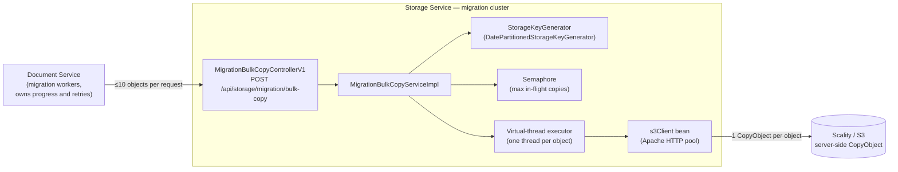
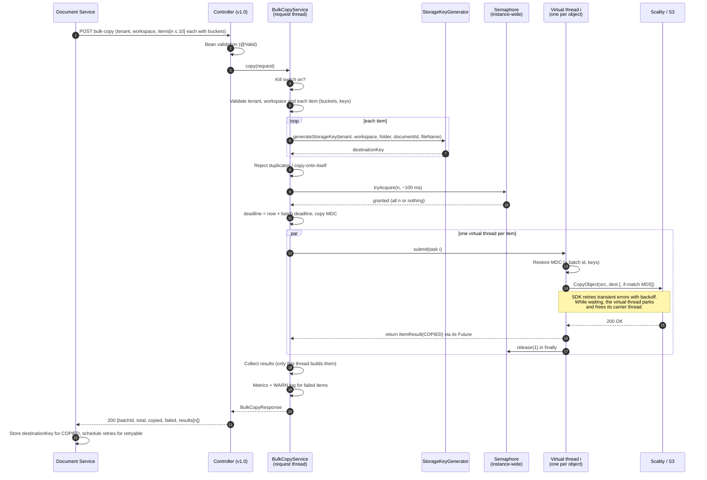
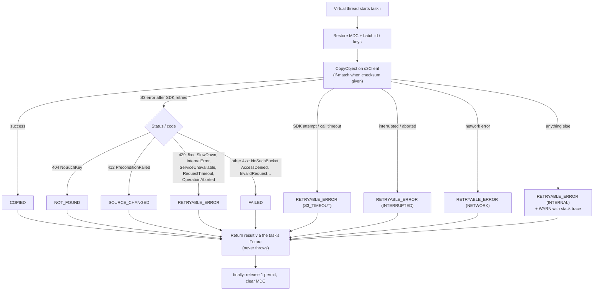
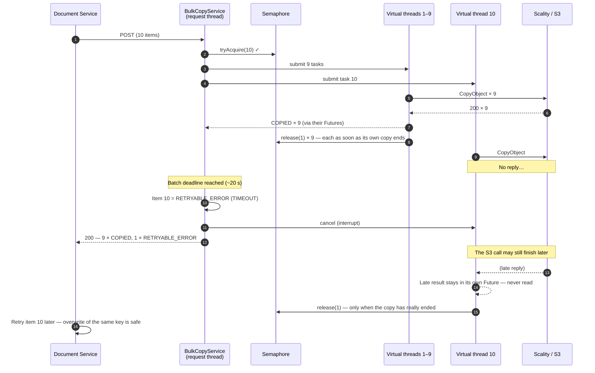
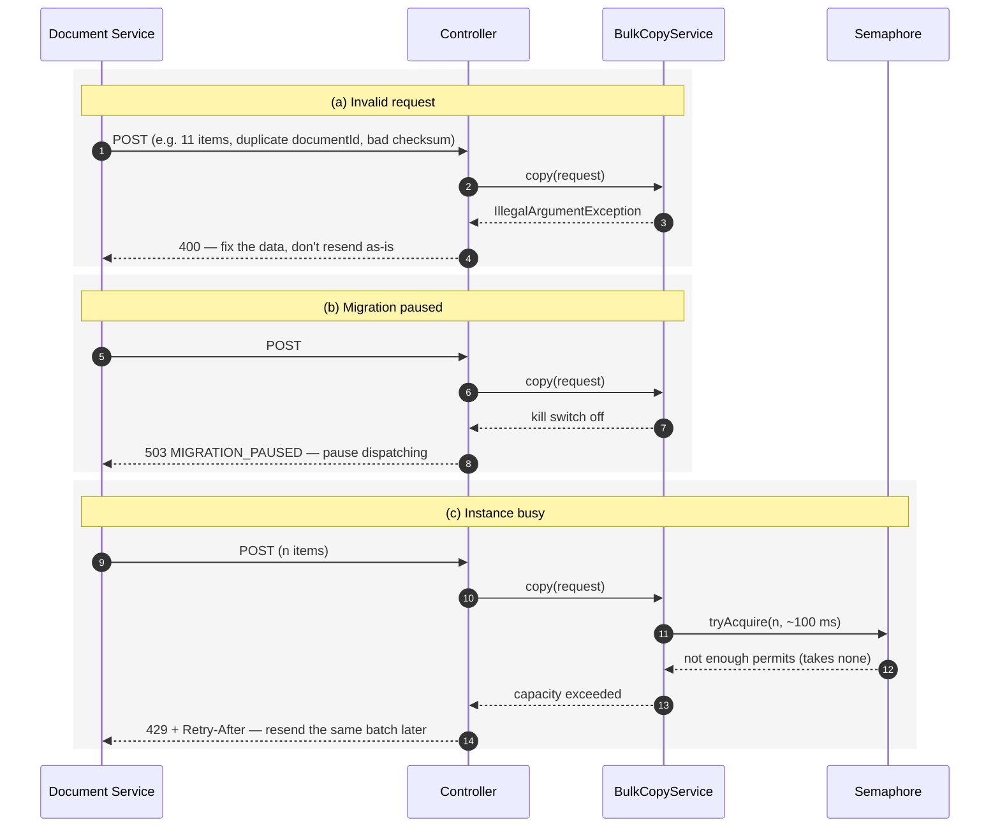
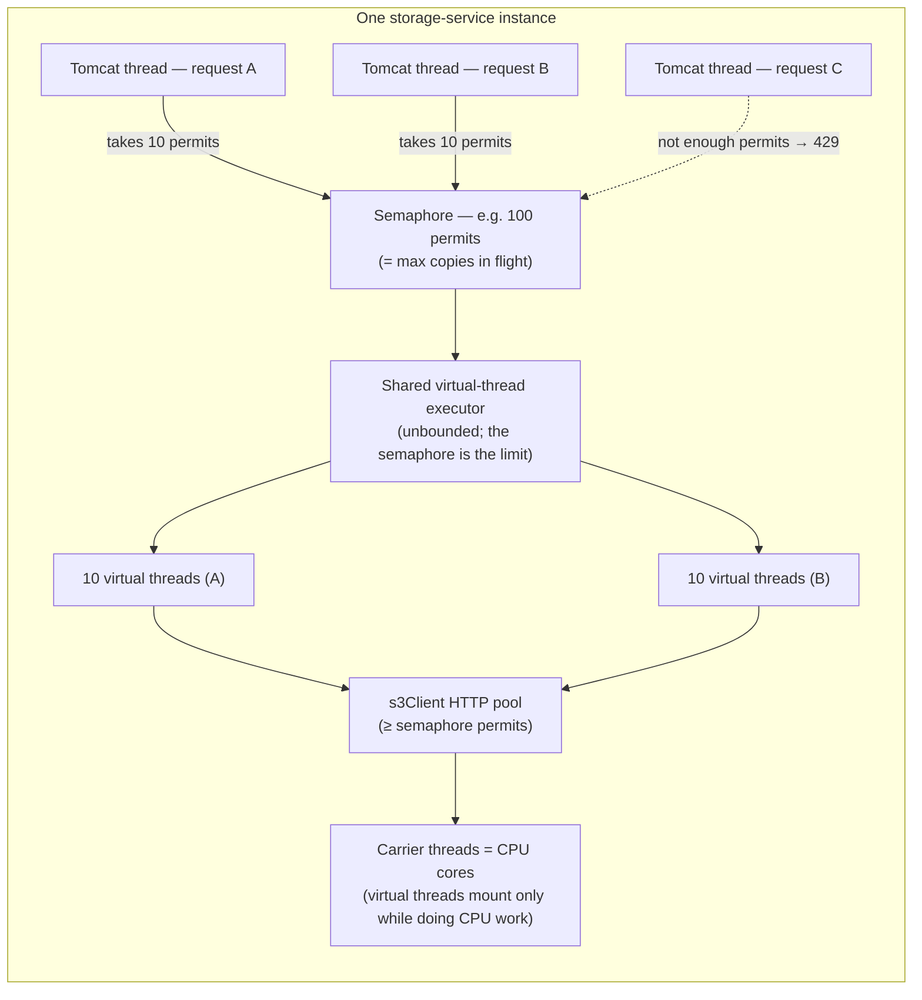
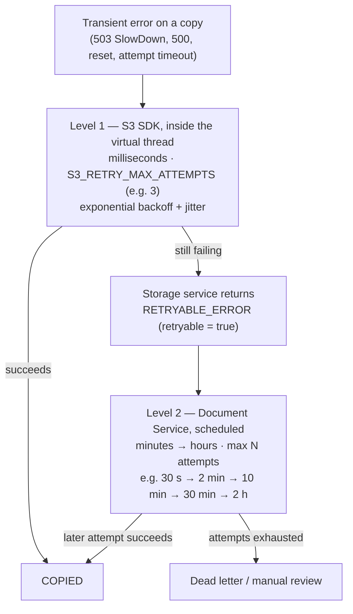

# Bulk Migration Copy API

`POST /api/storage/migration/bulk-copy` copies a small batch of objects from one bucket to another **inside the object store** (server-side `CopyObject`), in parallel, and returns one result per object.

It exists for the large-scale document migration (about 9 billion objects, 50 KB–1 MB each), where every saved S3 call and every millisecond per object matters. It is a **new, separate endpoint**: the existing copy APIs (`/files/copy`, `/files/copy-with-reconciliation`) are unchanged.

> Diagrams use [Mermaid](https://mermaid.js.org/). They render on GitHub/GitLab and in IDEs with Mermaid preview support; the text is readable either way.

---

## Contents

1. [At a glance](#1-at-a-glance)
2. [Request and response](#2-request-and-response)
3. [Destination key](#3-destination-key)
4. [Item statuses and what the caller should do](#4-item-statuses-and-what-the-caller-should-do)
5. [Architecture](#5-architecture)
6. [Sequence diagrams](#6-sequence-diagrams)
7. [Concurrency model](#7-concurrency-model)
8. [Retries](#8-retries)
9. [Timeouts and the batch deadline](#9-timeouts-and-the-batch-deadline)
10. [Configuration](#10-configuration)
11. [Observability](#11-observability)
12. [Deployment notes](#12-deployment-notes)
13. [Code map](#13-code-map)

---

## 1. At a glance

| | |
|---|---|
| **Endpoint** | `POST /api/storage/migration/bulk-copy` |
| **API version** | `X-API-Version: 1.0` (or omitted; 1.0 is the default) |
| **Batch size** | 1–10 objects per request (configurable) |
| **S3 calls per object** | **Exactly 1** (`CopyObject`). No HeadBucket, no HeadObject. |
| **Destination key** | Built by the storage service (same layout as upload) and returned per item |
| **Integrity check** | Optional MD5 per item, enforced server-side with `x-amz-copy-source-if-match` |
| **Parallelism** | One virtual thread per object, capped per instance by a semaphore |
| **Response** | HTTP 200 with one result per item, even when some items fail |
| **Whole-request rejections** | 400 invalid request · 429 instance busy · 503 migration paused (nothing copied in all three) |

---

## 2. Request and response

### Request

```http
POST /api/storage/migration/bulk-copy
Content-Type: application/json
X-API-Version: 1.0
```

```json
{
  "tenantId": "tenant-abc",
  "workspaceId": "ws-xyz",
  "items": [
    {
      "sourceBucket": "legacy-documents",
      "destinationBucket": "teamsync-documents-07",
      "sourceKey": "2019/04/scan-000123.pdf",
      "documentId": "doc-456",
      "folderId": "app-789",
      "fileName": "Invoice.pdf",
      "checksum": "9e107d9d372bb6826bd81d3542a419d6"
    }
  ]
}
```

| Field | Required | Notes |
|---|---|---|
| `tenantId` | yes | Used in the destination key |
| `workspaceId` | yes | Used in the destination key |
| `items` | yes | 1 to `max-items-per-request` (default 10) |
| `items[].sourceBucket` | yes | Bucket to copy this item from. Items in one request can use different buckets. |
| `items[].destinationBucket` | yes | Bucket to copy this item to. Must already exist, and must be in the allowlist if one is configured. |
| `items[].sourceKey` | yes | Used **exactly as sent** (no trimming). Max 1024 bytes, no control characters. |
| `items[].documentId` | yes | Becomes the object name in the destination key |
| `items[].folderId` | no | Folder (application) segment of the destination key; omitted if absent |
| `items[].fileName` | no | Only its extension is used. If absent, the extension comes from `sourceKey`. |
| `items[].checksum` | no | MD5 of the source, as 32-char hex or Base64. When present, the copy only happens if the source ETag still matches. |

### Response (HTTP 200)

```json
{
  "success": true,
  "message": "2 of 3 objects copied; see per-item results",
  "data": {
    "batchId": "3f1c9a0e-5b7d-4c1e-9a55-0d6c2b7e8f10",
    "total": 3,
    "copied": 2,
    "failed": 1,
    "results": [
      {
        "sourceBucket": "legacy-documents",
        "sourceKey": "2019/04/scan-000123.pdf",
        "destinationBucket": "teamsync-documents-07",
        "documentId": "doc-456",
        "destinationKey": "tenant-abc/ws-xyz/2026/10/app-789/doc-456.pdf",
        "status": "COPIED",
        "retryable": false
      },
      {
        "sourceBucket": "legacy-documents",
        "sourceKey": "2019/04/scan-000124.pdf",
        "destinationBucket": "teamsync-documents-07",
        "documentId": "doc-457",
        "destinationKey": "tenant-abc/ws-xyz/2026/10/app-789/doc-457.pdf",
        "status": "COPIED",
        "retryable": false
      },
      {
        "sourceBucket": "legacy-documents",
        "sourceKey": "2019/04/scan-000125.pdf",
        "destinationBucket": "teamsync-documents-07",
        "documentId": "doc-458",
        "destinationKey": "tenant-abc/ws-xyz/2026/10/app-789/doc-458.pdf",
        "status": "RETRYABLE_ERROR",
        "retryable": true,
        "attempts": 3,
        "errorCode": "SlowDown",
        "httpStatus": 503,
        "message": "Please reduce your request rate.",
        "s3RequestId": "a1b2c3d4"
      }
    ]
  },
  "timestamp": "2026-10-08T10:15:30Z"
}
```

- `results` are in the **same order** as `items`, and every item always has a result. `sourceBucket`, `destinationBucket` and `documentId` are echoed so results can also be matched without relying on order.
- Failure details (`attempts`, `errorCode`, `httpStatus`, `message`, `s3RequestId`) appear only on failed items.
- No checksum and no file size are returned.

### Whole-request errors (nothing was copied)

| HTTP | `code` | Meaning | Caller action |
|---|---|---|---|
| 400 | `VALIDATION_ERROR` / `BAD_REQUEST` | Invalid request (see [validation rules](#validation-rules)) | Fix the data. Don't resend as-is. |
| 429 | `MIGRATION_CAPACITY_EXCEEDED` | Instance busy; `Retry-After` header set | Resend the **same** batch after `Retry-After`. Don't count it as an item attempt. |
| 503 | `MIGRATION_PAUSED` | Kill switch is off | Pause dispatching; resend later. |

### Validation rules

The whole batch is rejected with 400, before any copy starts, if:

- a required field is missing or blank
- `items` is empty or has more than `max-items-per-request` entries
- a `sourceKey` is longer than 1024 bytes or contains control characters
- `checksum` is present but isn't a valid MD5 (32-char hex or 16-byte Base64)
- an item's `destinationBucket` isn't in the configured allowlist
- two items produce the **same destination object** (same destination bucket and same generated key, for example the same `documentId` twice into one bucket). The same key in two **different** destination buckets is allowed.
- source and destination are the same object (same bucket and same key)

---

## 3. Destination key

The storage service builds the destination key; the caller doesn't. The default layout is the same one the upload, multipart and copy paths use:

```
{tenantId}/{workspaceId}/{yyyy}/{MM}/[{folderId}/]{documentId}[.ext]
```

| Input | Example | Result |
|---|---|---|
| With folder | tenant `t1`, workspace `ws1`, folder `app-9`, document `doc-1`, file `Invoice.PDF` | `t1/ws1/2026/10/app-9/doc-1.pdf` |
| No folder | same, without `folderId` | `t1/ws1/2026/10/doc-1.pdf` |
| No extension | file name `README` | `t1/ws1/2026/10/app-9/doc-1` |

- `yyyy/MM` is the **current date** on the storage service.
- The extension is lowercased and taken from the last path segment of `fileName` (or of `sourceKey` when `fileName` is absent).
- **The caller must store the `destinationKey` returned in the response** for each document.

**Changing the layout:** the key is built behind the `StorageKeyGenerator` interface (`keygen` package). To change it, add another implementation marked `@Primary`; the bulk copy code doesn't change.

**Retries across a month boundary:** because `yyyy/MM` is the current date, a retry in a new month produces a different key. That's fine as long as the caller stores the key from the response it accepts. The only side effect: if an earlier attempt actually copied the object but its response was lost, that copy remains under the old month's path.

---

## 4. Item statuses and what the caller should do

| Status | `retryable` | Cause | Caller action |
|---|---|---|---|
| `COPIED` | false | Copy succeeded (possibly after SDK retries) | Mark done; store `destinationKey` |
| `NOT_FOUND` | false | Source object doesn't exist (`NoSuchKey`) | Don't retry. Put on the review list. |
| `SOURCE_CHANGED` | false | `checksum` didn't match the source ETag (`412 PreconditionFailed`) | Don't retry. Review the source. |
| `FAILED` | false | Permanent error: `NoSuchBucket`, `AccessDenied`, `InvalidRequest`, clock skew, other 4xx | Don't retry. **Alert**: usually configuration. |
| `RETRYABLE_ERROR` | true | Transient: throttling, 5xx, network, S3 timeout, batch deadline, interruption | Retry **later** with backoff, up to a maximum number of attempts, then dead-letter |

`errorCode` values for `RETRYABLE_ERROR`:

| `errorCode` | Meaning |
|---|---|
| `SlowDown`, `ServiceUnavailable`, `InternalError`, `RequestTimeout`, `OperationAborted`, or any 429/5xx code | Object store reported a transient error after the SDK's retries |
| `S3_TIMEOUT` | SDK attempt/call timeout reached |
| `NETWORK` | Connection or I/O failure |
| `TIMEOUT` | The [batch deadline](#9-timeouts-and-the-batch-deadline) was reached before this copy finished |
| `INTERRUPTED` | The copy was interrupted (deadline cancellation or shutdown) |
| `SHUTTING_DOWN` | The instance was shutting down; the copy didn't start |
| `INTERNAL` | Unexpected error in the storage service (logged at WARN with a stack trace) |

**Is a retry safe?** Yes. Copying to the same destination key again simply overwrites it with the same content.

---

## 5. Architecture



**Responsibilities**

| Component | Owns |
|---|---|
| Document service | Which documents to migrate, pacing, progress per document, scheduled retries, dead-letter, storing `destinationKey` |
| Storage service | Validation, destination key, admission control, parallel copies, error classification. **Stateless**: it remembers nothing between requests. |
| Object store | The actual data copy. Bytes never pass through the storage service. |

---

## 6. Sequence diagrams

### 6.1 Main flow



### 6.2 Inside one copy task (error classification)



### 6.3 Batch deadline (one copy stuck)



Why the late result can't corrupt anything: each task returns its result through **its own `Future`**, and only the request thread builds the response. After the deadline, nothing reads task 10's future again.

Why the permit is released by the task and not at the deadline: if the request thread released it at the deadline, the semaphore would think one fewer copy was running while task 10 was still holding a connection, so the instance could exceed its limit.

### 6.4 Whole-request rejections



---

## 7. Concurrency model



| Rule | Why |
|---|---|
| **One** semaphore and **one** executor per instance (fields of a singleton service) | A semaphore created per request would limit nothing |
| `tryAcquire(n)` is all-or-nothing | A batch never runs half-admitted; a 429 means nothing ran |
| Semaphore permits ≤ S3 connection pool size | Every admitted copy gets a connection immediately |
| One virtual thread per object | No pool to size; a thread waiting on Scality costs a few KB and frees its carrier thread |
| Each task **returns** its result; no shared result array | Only the request thread writes results, so there's no race |
| Each task releases **its own** permit in `finally` (exactly once) | The permit count always equals copies really running, even after a deadline |
| A task cancelled before it starts has its permit released by the request thread | Otherwise it would never reach `finally` and the permit would be lost |
| The executor is a private field, **not** a Spring `Executor` bean | Spring Boot's default task executor and existing APIs are unaffected |
| `spring.threads.virtual.enabled` is **not** set | Tomcat and existing APIs keep their current threads |

**What a request costs:** 1 Tomcat thread (waiting) + n virtual threads + n permits + up to n S3 connections. Virtual threads end when their copy ends.

**Context propagation:** a new virtual thread starts with an empty MDC, so the request's MDC (correlation id, tenant, workspace, session…) is copied into each task, plus `batch.id`, `source.key` and `destination.key`, and cleared at the end. `TenantContext` and `PermissionService` are not used by this API.

---

## 8. Retries

Retries happen at two levels with different time scales. Nothing is retried in a third place.



| Level | Who | Handles | Time scale |
|---|---|---|---|
| 1 | AWS SDK (`s3Client`) | Short transient blips | Milliseconds |
| 2 | Document service | Anything still failing; longer outages | Minutes to hours |

- **Not retried by anyone automatically:** `NOT_FOUND`, `SOURCE_CHANGED`, `FAILED`.
- During SDK backoff, the virtual thread sleeps without blocking a carrier thread, and the S3 connection goes back to the pool. Its **permit stays held**, so keep SDK retries small (2–3 attempts).
- A 429 or 503 for the whole request isn't an item attempt: nothing ran.

---

## 9. Timeouts and the batch deadline

The **batch deadline** is the longest one request waits for all of its copies. It's computed **once per request** (`now + MIGRATION_BATCH_DEADLINE_MS`), and each future is waited on only for the time remaining. When it's reached, unfinished copies are reported as `RETRYABLE_ERROR (TIMEOUT)` and cancelled, and the response is sent.

Each layer must give up before the layer around it:

```
S3 attempt timeout   <   S3 call timeout     <   batch deadline   <   caller HTTP timeout
     ~5 s                 ~12 s (all attempts)      ~20 s                 ~30 s
```

| Setting | Env variable | Suggested (migration cluster) |
|---|---|---|
| S3 attempt timeout | `S3_API_CALL_ATTEMPT_TIMEOUT_MS` | 5000 |
| S3 call timeout (all attempts) | `S3_API_CALL_TIMEOUT_MS` | 12000 |
| Batch deadline | `MIGRATION_BATCH_DEADLINE_MS` | 20000 (default) |
| Caller HTTP timeout | document-service config | ~30000 |

Normal copies of 50 KB–1 MB take tens to hundreds of milliseconds, so the deadline is a safety net. If it fires often, that's a signal the object store is saturated.

---

## 10. Configuration

All settings come from environment variables, read at startup (changing one needs a pod restart). The live cluster sets none of the new ones and behaves exactly as before.

### Bulk migration API

| Env variable | Default | Meaning |
|---|---|---|
| `MIGRATION_BULK_COPY_ENABLED` | `true` | Kill switch. `false` → every request gets 503. |
| `MIGRATION_MAX_ITEMS_PER_REQUEST` | `10` | Maximum items per request |
| `MIGRATION_MAX_IN_FLIGHT_COPIES` | `100` | Semaphore permits per instance. Must be ≥ max items per request (startup fails otherwise). |
| `MIGRATION_PERMIT_WAIT_MS` | `100` | How long a request waits for permits before 429 |
| `MIGRATION_RETRY_AFTER_SECONDS` | `1` | `Retry-After` value on 429 |
| `MIGRATION_BATCH_DEADLINE_MS` | `20000` | Batch deadline |
| `MIGRATION_AUTO_CREATE_DEST_BUCKET` | `false` | When `true`, a copy that fails because its **destination** bucket is missing creates it (with versioning) and retries once. Missing source buckets are never created. Pair it with the allowlist (a startup WARN is logged if the allowlist is empty). |
| `MIGRATION_ALLOWED_DEST_BUCKETS` | *(empty)* | Comma-separated destination-bucket allowlist; empty = any bucket |

### S3 client (shared `s3Client` bean)

| Env variable | Default | Meaning |
|---|---|---|
| `S3_HTTP_MAX_CONNECTIONS` | `100` | Connection pool size. Keep ≥ `MIGRATION_MAX_IN_FLIGHT_COPIES` (a startup warning is logged otherwise). |
| `S3_HTTP_CONN_ACQUISITION_TIMEOUT` | `10` (s) | Wait for a pooled connection |
| `S3_HTTP_SOCKET_TIMEOUT` | `60` (s) | Socket read timeout |
| `S3_RETRY_MAX_ATTEMPTS` | `0` | SDK attempts per call. **0 = SDK default** (unchanged behavior). |
| `S3_API_CALL_ATTEMPT_TIMEOUT_MS` | `0` | Per-attempt timeout. **0 = not set.** |
| `S3_API_CALL_TIMEOUT_MS` | `0` | Whole-call timeout (all attempts). **0 = not set.** |

### Example: migration cluster

```properties
MIGRATION_MAX_IN_FLIGHT_COPIES=300
MIGRATION_BATCH_DEADLINE_MS=20000
MIGRATION_ALLOWED_DEST_BUCKETS=teamsync-documents-01,teamsync-documents-02

S3_HTTP_MAX_CONNECTIONS=300
S3_HTTP_CONN_ACQUISITION_TIMEOUT=2
S3_HTTP_SOCKET_TIMEOUT=10
S3_RETRY_MAX_ATTEMPTS=3
S3_API_CALL_ATTEMPT_TIMEOUT_MS=5000
S3_API_CALL_TIMEOUT_MS=12000
```

Start with lower values (for example 100 permits / 100 connections) and raise them step by step during load testing until copies/sec stops increasing or latency and `SlowDown` errors start rising.

---

## 11. Observability

### Metrics (Micrometer)

| Metric | Type | Tags | Use |
|---|---|---|---|
| `storage_migration_bulk_copy_items_total` | counter | `status`, `code` | Copies by outcome and error code |
| `storage_migration_bulk_copy_batch` | timer | — | Time per batch |
| `storage_migration_bulk_copy_rejected_total` | counter | `reason` = `capacity` / `paused` | 429 and 503 rejections |
| `storage_migration_bulk_copy_in_flight` | gauge | — | Copies currently running on the instance |

Suggested alerts: `FAILED` count > 0 (usually configuration), rising `RETRYABLE_ERROR` with `code=SlowDown`, sustained `capacity` rejections, `in_flight` constantly at the maximum.

### Logs

| Event | Level | Example |
|---|---|---|
| Item failed | WARN (one line per failed item) | `bulk_copy_item_failed batchId=… status=RETRYABLE_ERROR code=SlowDown httpStatus=503 attempts=3 source=… destination=… s3RequestId=… message="…"` |
| Unexpected error inside a copy | WARN with stack trace | `bulk_copy_unexpected_error sourceKey=… destinationKey=…` |
| Batch summary | DEBUG | `bulk_copy_batch_done batchId=… total=10 copied=10 failed=0 ms=143` |
| Config warning at startup | WARN | `bulk_copy_config max-in-flight-copies=… exceeds S3 max-connections=…` |

Successful copies are **not** logged at INFO, since at billions of objects that would be billions of lines. Every log line from a copy task carries the request's MDC (correlation id, tenant, workspace) plus `batch.id`. Use `batchId` from the response to find the matching log lines, and `s3RequestId` when raising issues with Scality.

---

## 12. Deployment notes

- **Dedicated migration cluster.** Run this service build as a separate deployment that receives only migration traffic, with the settings in [section 10](#10-configuration). The live cluster keeps its defaults.
- **Object store load is still shared.** A separate service cluster isolates the JVMs, not Scality. Pace the migration from the document service, and use the kill switch if live traffic suffers.
- **Destination buckets.** By default the bulk API never creates buckets; a missing bucket returns `FAILED (NoSuchBucket)` with a message naming which bucket (source or destination) is missing. Either pre-create them, or set `MIGRATION_AUTO_CREATE_DEST_BUCKET=true` (together with `MIGRATION_ALLOWED_DEST_BUCKETS`) to create a missing destination bucket on first use. Auto-created buckets have versioning enabled.
- **Versioning on destination buckets.** With versioning enabled, every retry of an already-copied object adds a version. Decide whether to suspend it during the migration.
- **Kafka consumer on the migration cluster.** `BucketMoveEventConsumer` uses the hard-coded consumer group `storage-service`. If the migration cluster connects to the same Kafka, its instances join the live group and process live bucket-move events. Disable or isolate this before deploying there.
- **Checksum check on Scality.** Before the migration, verify on the target Scality that a copy with the correct MD5 succeeds and one with a wrong MD5 returns 412 with nothing copied. Objects uploaded with **multipart** have an ETag like `"<hex>-<parts>"`, which never matches an MD5, so those items would come back as `SOURCE_CHANGED`. Spot-check source ETags first.
- **Graceful shutdown.** On shutdown the copy executor stops accepting work and waits up to the batch deadline + 5 s for in-flight copies (virtual threads are daemon threads).
- **Virtual-thread pinning.** During load tests run with `-Djdk.tracePinnedThreads=short` to check that the HTTP client doesn't pin carrier threads on Java 21.

---

## 13. Code map

| File | Role |
|---|---|
| `controller/v1_0/MigrationBulkCopyControllerV1.java` | Endpoint |
| `service/MigrationBulkCopyService.java` | Service interface |
| `service/impl/MigrationBulkCopyServiceImpl.java` | Validation, admission, virtual-thread fan-out/fan-in, deadline, classification, metrics |
| `keygen/StorageKeyGenerator.java` | Destination key interface (`generateStorageKey`) |
| `keygen/StorageKeyInput.java` | Key inputs: tenant, workspace, folder, document id, file name |
| `keygen/DatePartitionedStorageKeyGenerator.java` | Default key layout |
| `config/MigrationBulkCopyProperties.java` | `teamsync.migration.bulk-copy.*` settings |
| `config/S3Config.java` | Optional `S3_RETRY_MAX_ATTEMPTS` / API-call timeouts (no effect when unset) |
| `dto/BulkCopyRequest.java`, `dto/BulkCopyItem.java` | Request |
| `dto/BulkCopyResponse.java`, `dto/BulkCopyItemResult.java`, `dto/BulkCopyItemStatus.java` | Response |
| `exception/MigrationCapacityExceededException.java`, `exception/MigrationPausedException.java` | Whole-request rejections |
| `exception/MigrationBulkCopyExceptionHandler.java` | `@RestControllerAdvice` scoped to the bulk controller, ordered before `GlobalExceptionHandler`: 429 + `Retry-After` (RFC 6585 / RFC 9110) and 503 (RFC 9110), `ApiResponse` body |

**Tests:** `MigrationBulkCopyServiceImplTest` (classification, if-match header, MDC propagation, validation, batch deadline and permit return, 429, kill switch, key generator inputs), `MigrationBulkCopyControllerV1Test`, `MigrationBulkCopyErrorResponseTest` (full MVC path: 429/503 status, headers and body; 400 still from the global handler), `DatePartitionedStorageKeyGeneratorTest`, `S3ConfigTest` (settings unset vs. set).
